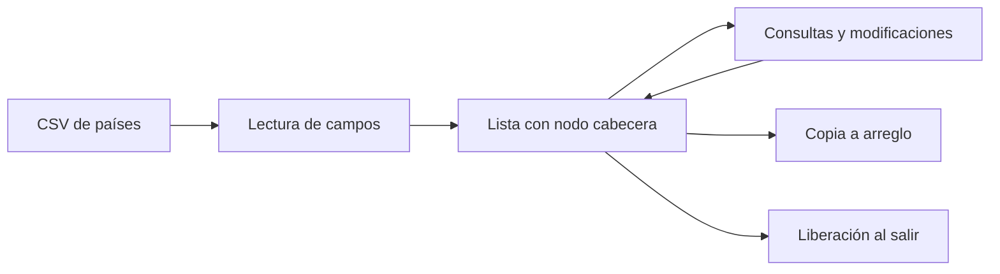

# Desarrollo — Gestión de países — Proyecto final

## Diseño y gestión de memoria

Un nodo cabecera representa la lista vacía sin almacenar un país. Cada nodo posee una copia de `country` y sus cadenas. Al insertar se realiza copia profunda; convertir a arreglo también crea copias independientes. Borrar o liberar debe destruir las cadenas, el país y el nodo, conservando la coherencia de enlaces anteriores/siguientes.

Las búsquedas y el conteo recorren la lista. El ordenamiento compara nombre, población, área o densidad y conserva los enlaces. El lector CSV trata comillas y campos con comas; el conjunto contiene 227 registros, incluidos nombres como `Congo, Dem. Rep.`. Una división ingenua por comas no es una validación válida del CSV.

Las comprobaciones posteriores verifican lista vacía, inserción en extremos, búsqueda, promedio, copia profunda, eliminación, cuatro criterios de ordenamiento, enlaces y carga CSV. Se utiliza el código real mediante inclusión con renombrado de `main`, sin duplicar la implementación.

La auditoría TXT original menciona sanitizadores. Es una declaración histórica de la entrega; la revisión publicada usa MSVC y no vuelve a certificar ASan/UBSan ni todas las condiciones de memoria posibles.

---

## Flujo de datos

El diagrama representa la organización de la implementación; no forma parte de los documentos entregados originalmente.

## Operaciones y complejidad

| Operación | Comportamiento de la implementación | Coste |
|---|---|---|
| Insertar al inicio | Reconecta el primer nodo y su enlace anterior. | O(1). |
| Insertar al final | Recorre hasta el último nodo. | O(n). |
| Buscar, contar o promediar PIB | Recorre la lista. | O(n), sin contar longitud de cadenas. |
| Eliminar por nombre | Localiza el nodo y reconecta sus vecinos. | O(n). |
| Convertir a arreglo | Crea copias de los países y sus cadenas. | O(n) más el tamaño de los textos copiados. |
| Ordenar | Pasadas de intercambios entre países vecinos. | O(n²) comparaciones en el peor caso. |

## Invariantes de memoria

- La cabecera no posee un país; su siguiente referencia inicia la colección.
- El primer nodo apunta hacia la cabecera y cada enlace siguiente tiene su anterior correspondiente.
- Una copia de país es propietaria de sus cadenas: modificar una copia a arreglo no modifica el nombre en la lista.
- Eliminar un elemento libera sus cadenas y registro; liberar la lista deja vacía la referencia de la cabecera.

Los controles verifican estos aspectos con datos sintéticos y con la carga de 227 registros. No equivalen a una certificación nueva de sanitizadores o de todas las situaciones de memoria posibles.

---

[Actividad](README.md) · [Resultados comunes](../VALIDACION.md)
