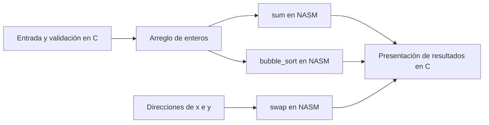

# Desarrollo — Proyecto híbrido C y NASM

## Diseño e interoperabilidad

C reúne la entrada y llama a tres rutinas NASM. Windows x64 pasa los primeros argumentos enteros/punteros en RCX, RDX, R8 y R9; `sum` devuelve su entero en EAX. Los procedimientos deben respetar los registros no volátiles de la ABI. Las rutinas son hojas y no llaman a la biblioteca C.

Para `[30,50,10,40,20]`, la suma esperada es 150 y el arreglo ordenado es `[10,20,30,40,50]`. Intercambiar `x=4, y=-7` produce `x=-7, y=4`. También se comprueba recuperación ante tamaño cero y texto no numérico.

El programa admite entre 1 y 20 enteros. La suma usa enteros de 32 bits: los ejemplos no validan desbordamiento. El cierre abrupto de la entrada no está cubierto por las pruebas actuales.

---

## Flujo de la solución

El diagrama resume el código publicado; se elaboró para esta documentación.

## Contrato de las funciones

| Función | Entrada | Efecto o resultado | Coste |
|---|---|---|---|
| `sum` | Dirección del arreglo y cantidad. | Devuelve el total en EAX. | O(n). |
| `bubble_sort` | Dirección del arreglo y cantidad. | Ordena el mismo arreglo de menor a mayor. | O(n²). |
| `swap` | Direcciones de dos enteros. | Intercambia sus valores. | O(1). |

El código de las rutinas no reserva un arreglo adicional. Los límites de entero y el fin abrupto de la entrada requieren un tratamiento adicional si se amplía el ejercicio más allá de los casos académicos.

---

[Actividad](README.md) · [Resultados comunes](../VALIDACION.md)
