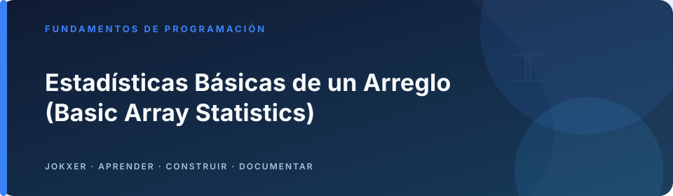

<div align="center">

<h1 align="center"></h1>


</div>

[Inicio](../../README.md) · [Materia](../README.md) · [Desarrollo](desarrollo.md) · [Código](solution.cs)


## En palabras simples


Con `2, 4, 9`, puedes recorrer la lista una vez y llevar tres recuerdos: suma, menor y mayor. La suma es 15; al dividir entre 3 sale un promedio de 5. El menor es 2 y el mayor es 9.

## Qué trabajé y cómo leer los ejemplos

Recorro los datos para obtener suma, promedio y extremos. El promedio es la suma dividida entre la cantidad de elementos; no es el punto medio entre el mayor y el menor. En el análisis, n representa la cantidad de valores del arreglo.

## Planteamiento

Este ejercicio consiste en leer una cantidad de números enteros ingresados por el usuario y calcular estadísticas básicas sobre ellos.

El programa determina:

- La suma total de los elementos.
- El promedio.
- El número mayor.
- El número menor.

## Objetivo

Aplicar conceptos fundamentales de programación mediante el uso de variables, arreglos, ciclos, condicionales y métodos.

## Entrada

El programa solicita primero la cantidad de números que tendrá el arreglo.

Luego solicita cada número de forma individual.

Ejemplo:

```text
Ingrese la cantidad de números: 5
Ingrese el número 1: 10
Ingrese el número 2: 4
Ingrese el número 3: 8
Ingrese el número 4: 20
Ingrese el número 5: 6
```

## Salida

El programa muestra la suma, el promedio, el número mayor y el número menor.

Ejemplo:

```text
Suma total: 48
Promedio: 9.6
Número mayor: 20
Número menor: 4
```

## Conceptos aplicados

- Entrada de datos
- Variables
- Arreglos
- Ciclos
- Condicionales
- Métodos
- Validación básica
- Operaciones aritméticas

## Análisis del algoritmo

El programa guarda los números en un arreglo.

Luego recorre el arreglo para calcular la suma total, encontrar el número mayor y encontrar el número menor.

El promedio se obtiene dividiendo la suma total entre la cantidad de elementos.

## Complejidad

- Tiempo: O(n)
- Espacio: O(n)

## Lenguaje utilizado

C#

---

[Volver a la materia](../README.md) · [Notación y estados](../../GUIA-DE-LECTURA.md)
