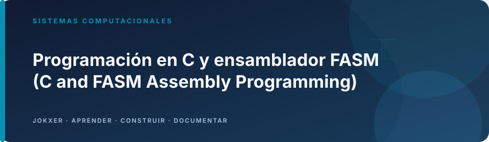

<div align="center">

<h1 align="center"></h1>


</div>

[Inicio](../../README.md) · [Materia](../README.md) · [Desarrollo](desarrollo.md) · [C](c) · [FASM](fasm-linux)


---

## En palabras simples


Los mismos problemas se escriben en C y en ensamblador. Mira primero qué recibe y qué devuelve cada pareja: el objetivo es que ambos programas hagan el mismo trabajo, aunque uno use instrucciones más detalladas.

### Ejercicios de esta carpeta, uno por uno

- **Saludo al mundo:** Imprime un saludo; observa cómo se envía texto a la consola. ([01-saludo-mundo.c](c/01-saludo-mundo.c) · [01-saludo-mundo.asm](fasm-linux/01-saludo-mundo.asm))
- **Suma, resta y producto de enteros:** Con dos enteros, compara suma, resta y producto. ([02-operaciones-enteros.c](c/02-operaciones-enteros.c) · [02-operaciones-enteros.asm](fasm-linux/02-operaciones-enteros.asm))
- **Suma condicional:** Si los dos números son iguales, revisa la regla especial que duplica la suma. ([03-suma-condicional.c](c/03-suma-condicional.c) · [03-suma-condicional.asm](fasm-linux/03-suma-condicional.asm))
- **Cuenta regresiva entre extremos:** Empieza en el extremo mayor y muestra un valor menos en cada vuelta. ([04-cuenta-regresiva.c](c/04-cuenta-regresiva.c) · [04-cuenta-regresiva.asm](fasm-linux/04-cuenta-regresiva.asm))
- **Conteo dentro del rango 100–200:** Comprueba qué valores caen entre 100 y 200 y cuenta los que cumplen. ([05-rango-100-200.c](c/05-rango-100-200.c) · [05-rango-100-200.asm](fasm-linux/05-rango-100-200.asm))
- **Primalidad:** Prueba si el número tiene un divisor distinto de 1 y de sí mismo. ([06-numero-primo.c](c/06-numero-primo.c) · [06-numero-primo.asm](fasm-linux/06-numero-primo.asm))
- **Primos hasta N:** Repite la prueba de primalidad para generar los primos hasta el límite. ([07-primos-hasta-n.c](c/07-primos-hasta-n.c) · [07-primos-hasta-n.asm](fasm-linux/07-primos-hasta-n.asm))
- **Cuadrado hueco:** Dibuja el borde con asteriscos y deja el centro vacío. ([08-cuadrado-hueco.c](c/08-cuadrado-hueco.c) · [08-cuadrado-hueco.asm](fasm-linux/08-cuadrado-hueco.asm))
- **Escalera ascendente:** Aumenta la cantidad de asteriscos al avanzar de fila. ([09-escalera-ascendente.c](c/09-escalera-ascendente.c) · [09-escalera-ascendente.asm](fasm-linux/09-escalera-ascendente.asm))
- **Escalera descendente:** Reduce la cantidad de asteriscos al avanzar de fila. ([10-escalera-descendente.c](c/10-escalera-descendente.c) · [10-escalera-descendente.asm](fasm-linux/10-escalera-descendente.asm))
- **Pirámide vertical:** Separa el total de filas de la cantidad de caracteres que lleva cada una. ([11-piramide-vertical.c](c/11-piramide-vertical.c) · [11-piramide-vertical.asm](fasm-linux/11-piramide-vertical.asm))
- **Escalera invertida:** Revisa cómo se combinan espacios y asteriscos para invertir la orientación. ([12-escalera-invertida.c](c/12-escalera-invertida.c) · [12-escalera-invertida.asm](fasm-linux/12-escalera-invertida.asm))

### Las cuatro preguntas por tema

| Tema | ¿Por qué? | ¿Para qué? | ¿Cómo? | ¿Cuándo usarlo? |
|---|---|---|---|---|
| Saludo al mundo | Una salida mínima permite comprobar el recorrido hasta la consola. | Ver que ambas versiones imprimen el saludo. | Ejecuta cada versión y compara el texto. | Al comenzar un programa de consola. |
| Suma, resta y producto de enteros | Cada operación usa los mismos operandos, pero la resta depende del orden. | Comparar tres resultados aritméticos entre lenguajes. | Usa dos enteros pequeños y calcula a mano suma, diferencia y producto. | Al verificar operaciones elementales con casos conocidos. |
| Suma condicional | Una condición activa una regla distinta para valores iguales. | Practicar una bifurcación con los mismos datos de entrada. | Prueba dos valores distintos y luego dos iguales; solo la rama de iguales duplica la suma. | Cuando un cálculo tiene un caso especial delimitado. |
| Cuenta regresiva entre extremos | La dirección del ciclo determina el orden de salida. | Imprimir un intervalo en orden descendente. | Identifica el mayor, réstale uno por vuelta y detente al llegar al menor. | Cuando debes recorrer números desde el límite superior. |
| Conteo dentro del rango 100–200 | El total debe incluir únicamente valores que cumplen la condición. | Contar elementos dentro de un intervalo. | Compara cada número con ambos límites e incrementa solo si pertenece. | Al filtrar mediciones o números por rango. |
| Primalidad | Un divisor propio basta para demostrar que un número no es primo. | Clasificar un entero como primo o no primo. | Contrasta `7` con `9`: encontrar `3` como divisor de `9` cambia la respuesta. | Cuando necesitas comprobar un candidato individual mayor que 1. |
| Primos hasta N | Una lista de primos requiere comprobar varios candidatos. | Generar los primos hasta un límite. | Recorre desde `2` hasta `N` y conserva los candidatos que pasen la prueba. | Cuando quieres enumerar primos en un rango pequeño. |
| Cuadrado hueco | Solo las celdas del borde llevan asterisco. | Distinguir interior y borde en una cuadrícula. | Para cada fila y columna, comprueba si estás en una primera o última posición. | Al generar marcos o dibujar perímetros con texto. |
| Escalera ascendente | El número de fila dicta cuánto crece el dibujo. | Representar una progresión de anchura. | Aumenta la cantidad de asteriscos en cada fila. | Cuando cada línea debe ser más ancha que la anterior. |
| Escalera descendente | La regla de crecimiento se invierte. | Dibujar un patrón que se estrecha. | Empieza con la fila más ancha y reduce el número de asteriscos al avanzar. | Cuando cada línea debe ser más corta que la anterior. |
| Pirámide vertical | Cantidad de filas y caracteres por fila son cálculos distintos. | Formar una figura fila a fila. | Dibuja una figura pequeña y registra cuántos caracteres toca imprimir por fila. | Al practicar ciclos anidados para figuras. |
| Escalera invertida | Cambiar solo los asteriscos no basta para cambiar la alineación. | Controlar sangría y anchura por separado. | Antes de cada fila, calcula los espacios y luego los asteriscos. | Cuando el diseño debe alinearse hacia el lado contrario. |

## Qué trabajé y cómo leer los ejemplos

Comparo doce problemas resueltos en C y FASM. Los prefijos 01–12 identifican ejercicios equivalentes entre ambos lenguajes; no indican dificultad ni calificación. Las 132 comparaciones registradas corresponden a casos de entrada y modos de ejecución, no a 132 programas distintos.

## Descripción de la actividad

Doce ejercicios equivalentes de entrada/salida, decisiones, ciclos, primos y patrones.

Materia: [Fundamentos de Sistemas Computacionales](../README.md). Autor de la entrega: Kelvin César Del Castillo Torres.

---

## Objetivo

Resolver los mismos problemas con C y ensamblador, comparando cómo se expresan entrada/salida, operaciones, condiciones y ciclos en un lenguaje de alto nivel y en instrucciones x86-64.

---

## Conceptos aplicados

- Entrada/salida con stdio y llamadas al sistema Linux.
- Aritmética entera, condiciones, saltos y registros.
- Ciclos, divisibilidad y generación de números primos.
- Patrones de asteriscos, espacios y validación de rangos.
- Comparación reproducible de resultados por pipe y terminal PTY.

---

## Actividad desarrollada

La colección contiene doce pares de soluciones. Los primeros ejercicios trabajan decisiones y recorridos numéricos; los últimos construyen figuras mediante ciclos anidados. Las tablas siguientes permiten abrir cada versión por separado sin mezclar la sintaxis FASM para Linux con la del proyecto NASM para Windows.

## Archivos y soluciones

| Ejercicio | C | FASM Linux x86-64 |
|---|---|---|
| Saludo al mundo | [01-saludo-mundo.c](c/01-saludo-mundo.c) | [01-saludo-mundo.asm](fasm-linux/01-saludo-mundo.asm) |
| Suma, resta y producto de enteros | [02-operaciones-enteros.c](c/02-operaciones-enteros.c) | [02-operaciones-enteros.asm](fasm-linux/02-operaciones-enteros.asm) |
| Suma condicional | [03-suma-condicional.c](c/03-suma-condicional.c) | [03-suma-condicional.asm](fasm-linux/03-suma-condicional.asm) |
| Cuenta regresiva entre extremos | [04-cuenta-regresiva.c](c/04-cuenta-regresiva.c) | [04-cuenta-regresiva.asm](fasm-linux/04-cuenta-regresiva.asm) |
| Conteo dentro del rango 100–200 | [05-rango-100-200.c](c/05-rango-100-200.c) | [05-rango-100-200.asm](fasm-linux/05-rango-100-200.asm) |
| Primalidad | [06-numero-primo.c](c/06-numero-primo.c) | [06-numero-primo.asm](fasm-linux/06-numero-primo.asm) |
| Primos hasta N | [07-primos-hasta-n.c](c/07-primos-hasta-n.c) | [07-primos-hasta-n.asm](fasm-linux/07-primos-hasta-n.asm) |
| Cuadrado hueco | [08-cuadrado-hueco.c](c/08-cuadrado-hueco.c) | [08-cuadrado-hueco.asm](fasm-linux/08-cuadrado-hueco.asm) |
| Escalera ascendente | [09-escalera-ascendente.c](c/09-escalera-ascendente.c) | [09-escalera-ascendente.asm](fasm-linux/09-escalera-ascendente.asm) |
| Escalera descendente | [10-escalera-descendente.c](c/10-escalera-descendente.c) | [10-escalera-descendente.asm](fasm-linux/10-escalera-descendente.asm) |
| Pirámide vertical | [11-piramide-vertical.c](c/11-piramide-vertical.c) | [11-piramide-vertical.asm](fasm-linux/11-piramide-vertical.asm) |
| Escalera invertida | [12-escalera-invertida.c](c/12-escalera-invertida.c) | [12-escalera-invertida.asm](fasm-linux/12-escalera-invertida.asm) |

Los archivos `.asm` usan **FASM**, formato ELF64 y llamadas al sistema Linux. NASM no acepta directamente esta sintaxis. En Windows se puede verificar su ensamblado; para ejecutarlos se necesita Linux x86-64. La comparación en Linux de los doce pares está verificada para los casos documentados: **132 correctos y 0 fallidos**, con pipe y terminal PTY. [Informe de pruebas y correcciones](../PRUEBAS-LINUX.md).

---

## Ejemplo de análisis y uso

| Ejercicio | Entrada | Resultado esperado |
|---|---|---|
| Operaciones de enteros | `5`, `3` | Suma `8`, resta `2`, producto `15`. |
| Suma condicional | `4`, `4` | `16`: se duplica la suma al ser iguales. |
| Primalidad | `13` / `1` | Primo / no primo. |

Cuadrado hueco con tamaño `3`:

```text
***
* *
***
```

La comparación conserva los espacios de las figuras; los mensajes de entrada pueden variar. [132 comparaciones correctas en Linux](../PRUEBAS-LINUX.md).

---

## Organización de esta carpeta

```text
c-y-ensamblador/
├── README.md
├── desarrollo.md
├── c/
│   └── 12 programas .c independientes
└── fasm-linux/
    └── 12 programas .asm con los mismos nombres base
```

---

## Cómo revisar la actividad

En Linux x86-64, con GCC y FASM instalados, se puede revisar el caso de primalidad desde esta carpeta:

```sh
gcc -std=c17 c/06-numero-primo.c -o /tmp/primo-c
fasm fasm-linux/06-numero-primo.asm /tmp/primo-asm
chmod +x /tmp/primo-asm
printf '13\n' | /tmp/primo-c
printf '13\n' | /tmp/primo-asm
```

Para contrastar los doce pares, seguir la [reproducción de la batería Linux](../PRUEBAS-LINUX.md).

---

## Relación con los archivos originales y validación

[Documento de la entrega](../../archivos-originales/fundamentos-sistemas-computacionales/documentos/hw02-v2.pdf). El [inventario](../../archivos-originales/fundamentos-sistemas-computacionales/INVENTARIO.md) permite rastrear las rutas y los hashes de origen.

Los resultados y sus límites están en [VALIDACION.md](../VALIDACION.md). Las correcciones se explican por separado de las entregas originales.

---

## Lenguaje y herramientas

C17 y GCC en Linux para la comparación; MSVC en la revisión Windows de C. FASM 1.73.32 genera ejecutables ELF64 para Linux x86-64.

## Estado de la actividad

Actividad organizada y documentada como parte del portafolio académico. Los resultados verificados y los límites se detallan en los informes enlazados; la documentación posterior se distingue de la evidencia de entrega.

[Desarrollo](desarrollo.md) · [Volver a la materia](../README.md) · [Repositorio](../../README.md)
