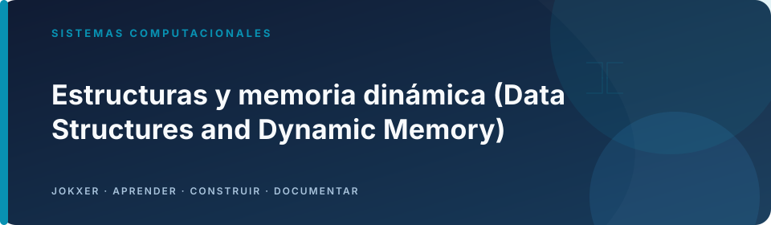

<div align="center">

<h1 align="center"></h1>


</div>

[Inicio](../../README.md) · [Materia](../README.md) · [Desarrollo](desarrollo.md) · [Código](.)


---

## En palabras simples


Una estructura guarda varios datos relacionados, como las esquinas de un rectángulo. Un puntero guarda dónde encontrar esos datos. Los ejercicios avanzan de agrupar valores a reservar espacio y devolverlo cuando ya no se necesita.

### Ejercicios de esta carpeta, uno por uno

- **Promedio de estudiantes:** Agrupa las notas de cada estudiante y calcula el promedio del registro. ([ejercicio-01.c](ejercicio-01.c))
- **Suma de tiempos con acarreo:** Suma segundos, minutos y horas; cuando una unidad llega a 60, pasa una a la siguiente. ([ejercicio-02.c](ejercicio-02.c))
- **Libros de mayor y menor precio:** Compara los precios y conserva los datos del libro más barato y del más caro. ([ejercicio-03.c](ejercicio-03.c))
- **Área de un rectángulo:** Obtén el ancho y el alto a partir de las esquinas y multiplícalos. ([ejercicio-04.c](ejercicio-04.c))
- **Pertenencia de un punto:** Compara las coordenadas del punto con los límites del rectángulo. ([ejercicio-05.c](ejercicio-05.c))
- **Rectángulo con memoria dinámica:** Reserva espacio para el rectángulo, úsalo y libéralo cuando termines. ([ejercicio-06.c](ejercicio-06.c))
- **Representación de complejos:** Guarda por separado las partes real e imaginaria de un mismo número. ([ejercicio-07.c](ejercicio-07.c))
- **Suma dinámica de complejos:** Suma reales con reales e imaginarias con imaginarias; guarda el resultado. ([ejercicio-08.c](ejercicio-08.c))
- **Complejo convertido a cadena:** Convierte los dos componentes del número a una forma que se pueda leer como texto. ([ejercicio-09.c](ejercicio-09.c))
- **Lista en orden directo e inverso:** Lee los nodos desde un extremo y luego muestra los valores en sentido contrario. ([ejercicio-10.c](ejercicio-10.c))

### Las cuatro preguntas por tema

| Tema | ¿Por qué? | ¿Para qué? | ¿Cómo? | ¿Cuándo usarlo? |
|---|---|---|---|---|
| Promedio de estudiantes | Las notas deben mantenerse asociadas al estudiante correcto. | Resumir el rendimiento de cada registro. | Agrupa las notas, suma las de un estudiante y divide entre su cantidad. | Cuando cada persona tiene varios valores del mismo tipo. |
| Suma de tiempos con acarreo | Los segundos y minutos se agrupan de 60 en 60. | Mostrar un tiempo con unidades normalizadas. | Suma los segundos; si alcanzan 60, pasa el acarreo a minutos y conserva el resto. | Al sumar duraciones expresadas en horas, minutos y segundos. |
| Libros de mayor y menor precio | El precio aislado no identifica qué libro lo tiene. | Recuperar los registros más caro y más barato. | Recorre los libros y conserva el registro completo junto a cada extremo. | Cuando debes seleccionar extremos y mostrar otros campos del ganador. |
| Área de un rectángulo | Las esquinas indican posiciones, no directamente tamaño. | Convertir coordenadas en superficie. | Calcula la distancia horizontal y la vertical y multiplícalas. | Cuando el rectángulo está definido por sus esquinas y sus lados siguen los ejes. |
| Pertenencia de un punto | Un punto puede coincidir en un eje y quedar fuera en el otro. | Comprobar ubicación respecto del rectángulo. | Contrasta por separado `x` e `y` con los límites correspondientes. | Al verificar regiones rectangulares, atendiendo a la regla de bordes del ejercicio. |
| Rectángulo con memoria dinámica | Un espacio reservado explícitamente también debe liberarse. | Practicar el ciclo de vida de una estructura. | Reserva el rectángulo, comprueba que se obtuvo memoria, úsala y libérala al terminar. | Cuando el almacenamiento se decide durante la ejecución y controlas su duración. |
| Representación de complejos | Un número complejo tiene dos componentes. | Guardar e identificar sus partes real e imaginaria. | Representa `2 + 3i` mediante los campos real `2` e imaginario `3`. | Al modelar un número complejo como un solo registro. |
| Suma dinámica de complejos | No se deben mezclar términos reales e imaginarios. | Construir el resultado de sumar dos complejos. | Suma real con real e imaginaria con imaginaria; guarda ambos resultados juntos. | Cuando calculas con registros complejos y necesitas conservar el resultado. |
| Complejo convertido a cadena | El registro interno no es un texto listo para mostrar. | Presentar el complejo de forma legible. | Formatea las dos partes y coloca el signo correspondiente entre ellas. | Al mostrar un complejo en pantalla o escribirlo como texto. |
| Lista en orden directo e inverso | El mismo conjunto puede recorrerse en dos sentidos. | Comprobar que se conserva el orden relativo de los elementos. | Con `1,2,3`, compara la salida directa con la inversa `3,2,1`. | Cuando necesitas presentar o revisar una secuencia en ambas direcciones. |

## Qué trabajé y cómo leer los ejemplos

Trabajo con estructuras y punteros para representar datos relacionados. Un puntero guarda una dirección de memoria; una dirección escrita en hexadecimal identifica una ubicación durante una ejecución y no debe interpretarse como el resultado numérico del problema.

## Descripción de la actividad

Diez ejercicios de estructuras, punteros, rectángulos, complejos y listas.

Materia: [Fundamentos de Sistemas Computacionales](../README.md). Autor de la entrega: Kelvin César Del Castillo Torres.

---

## Objetivo

Representar entidades mediante estructuras y trabajar con sus direcciones, relacionando almacenamiento automático, reserva dinámica y liberación de memoria con operaciones concretas.

---

## Conceptos aplicados

- Definición y acceso a miembros de struct.
- Punteros, paso por dirección y representación de cadenas.
- Reserva y liberación de memoria dinámica.
- Modelado de estudiantes, libros, tiempos, rectángulos y complejos.
- Construcción y recorrido de listas de nodos.

---

## Actividad desarrollada

Los diez programas avanzan desde registros y cálculos sobre estructuras hasta objetos reservados dinámicamente y recorridos de listas. Cada fuente mantiene su propio main: no se enlazan como si fueran un único programa.

## Archivos y soluciones

| Código | Ejercicio |
|---|---|
| [ejercicio-01.c](ejercicio-01.c) | Promedio de estudiantes |
| [ejercicio-02.c](ejercicio-02.c) | Suma de tiempos con acarreo |
| [ejercicio-03.c](ejercicio-03.c) | Libros de mayor y menor precio |
| [ejercicio-04.c](ejercicio-04.c) | Área de un rectángulo |
| [ejercicio-05.c](ejercicio-05.c) | Pertenencia de un punto |
| [ejercicio-06.c](ejercicio-06.c) | Rectángulo con memoria dinámica |
| [ejercicio-07.c](ejercicio-07.c) | Representación de complejos |
| [ejercicio-08.c](ejercicio-08.c) | Suma dinámica de complejos |
| [ejercicio-09.c](ejercicio-09.c) | Complejo convertido a cadena |
| [ejercicio-10.c](ejercicio-10.c) | Lista en orden directo e inverso |

Cada archivo tiene su propio `main`; se compila y ejecuta por separado. Los datos de ejemplo y límites del enunciado definen el alcance académico.

---

## Ejemplo de análisis y uso

| Programa | Datos de ejemplo | Resultado esperado |
|---|---|---|
| Suma de tiempos | `01:50:30` y `02:20:45` | `04:11:15`, aplicando los acarreos. |
| Área de rectángulo | Esquinas `(0,10)` y `(5,0)` | `50.00`. |
| Suma de complejos | `1 + j2` y `3 + j4` | `4.00 + j6.00`. |
| Recorrido inverso | Valores `5, 6, 7` | Orden directo `5, 6, 7`; inverso `7, 6, 5`. |

---

## Organización de esta carpeta

```text
estructuras-y-memoria/
├── README.md
├── desarrollo.md
├── ejercicio-01.c
├── ejercicio-02.c
├── ...
└── ejercicio-10.c
```

---

## Cómo revisar la actividad

Elegir una fuente y compilarla de forma independiente. En una consola de desarrollador de Visual Studio:

```text
cl /std:c17 /D_CRT_SECURE_NO_WARNINGS ejercicio-02.c /Fe:tiempos.exe
tiempos.exe
```

Introducir por separado horas, minutos y segundos de ambos tiempos. Los datos de la tabla permiten contrastar el resultado. La [validación común](../VALIDACION.md) registra los casos ejecutados.

---

## Relación con los archivos originales y validación

[Documento de la entrega](../../archivos-originales/fundamentos-sistemas-computacionales/documentos/hw03-v2.pdf). El [inventario](../../archivos-originales/fundamentos-sistemas-computacionales/INVENTARIO.md) permite rastrear las rutas y los hashes de origen.

Los resultados y sus límites están en [VALIDACION.md](../VALIDACION.md). Las correcciones se explican por separado de las entregas originales.

---

## Lenguaje y herramientas

C17, biblioteca estándar de C y herramientas C de Visual Studio en la validación registrada.

## Estado de la actividad

Actividad organizada y documentada como parte del portafolio académico. Los resultados verificados y los límites se detallan en los informes enlazados; la documentación posterior se distingue de la evidencia de entrega.

[Desarrollo](desarrollo.md) · [Volver a la materia](../README.md) · [Repositorio](../../README.md)
