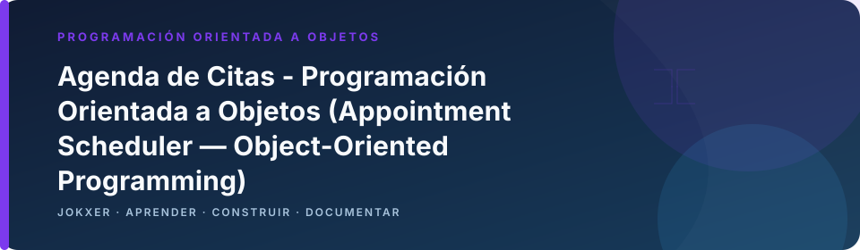

<div align="center">

<h1 align="center"></h1>


</div>

[Inicio](../../README.md) · [Materia](../README.md) · [Desarrollo](desarrollo.md) · [Código](solution.cs)


## En palabras simples


Una cita junta datos de una misma cosa, como fecha y motivo. La agenda organiza varias citas; el ejercicio muestra por qué conviene manejar cada una como un objeto y no guardar todos sus datos sueltos.

- **¿Por qué?** Una hora inválida no debería entrar a la lista de citas.
- **¿Para qué?** Para guardar los datos juntos y dejar que la agenda administre varias citas.
- **¿Cómo?** Crea una cita el lunes a las 09:30 e intenta otra a las 09:60; la segunda debe rechazarse.
- **¿Cuándo usarlo?** Cuando necesitas registrar elementos similares con reglas antes de agregarlos a una colección.

## Qué trabajé y cómo leer los ejemplos

Represento cada cita con sus datos y reúno las citas en una agenda. La hora y los minutos son campos distintos: 09:30 significa nueve horas y treinta minutos. Las validaciones evitan construir citas con horarios fuera del rango permitido.

## Planteamiento

Este ejercicio consiste en crear un programa para registrar y mostrar citas dentro de una agenda.

Cada cita contiene información sobre el día de la semana, la hora, los minutos y una descripción. El programa valida que los datos ingresados sean correctos antes de crear una cita.

## Objetivo

Aplicar principios de programación orientada a objetos para representar una agenda de citas utilizando clases, objetos, constructores y validaciones.

## Conceptos aplicados

- Clases
- Objetos
- Constructores
- Propiedades
- Encapsulación
- Enumeraciones
- Listas
- Validaciones
- Excepciones
- Métodos

## Estructura del programa

El programa contiene las siguientes partes:

### Enumeración `DiaSemana`

Representa los días de la semana disponibles para una cita.

### Clase `Cita`

Representa una cita individual.

Contiene:

- Día de la semana
- Hora
- Minuto
- Descripción

### Clase `AgendaMedica`

Representa una agenda que puede almacenar varias citas.

Contiene métodos para:

- Agregar una cita
- Mostrar todas las citas registradas

## Validaciones realizadas

El constructor de la clase `Cita` valida que:

- La hora esté entre 0 y 23.
- Los minutos estén entre 0 y 59.
- La descripción no esté vacía.

Si algún dato no es válido, el programa lanza una excepción de tipo `ArgumentException`.

## Ejemplo de salida

```text
Agenda de citas

Citas registradas:

Lunes - 09:30 - Consulta general
Miércoles - 14:00 - Revisión de resultados
Viernes - 16:45 - Seguimiento del paciente
```

## Análisis

Este ejercicio permite practicar el diseño de clases con responsabilidades claras.

La clase `Cita` se encarga de representar y validar los datos de una cita, mientras que la clase `AgendaMedica` administra el conjunto de citas registradas.

## Lenguaje utilizado

C#

---

[Volver a la materia](../README.md) · [Notación y estados](../../GUIA-DE-LECTURA.md)
