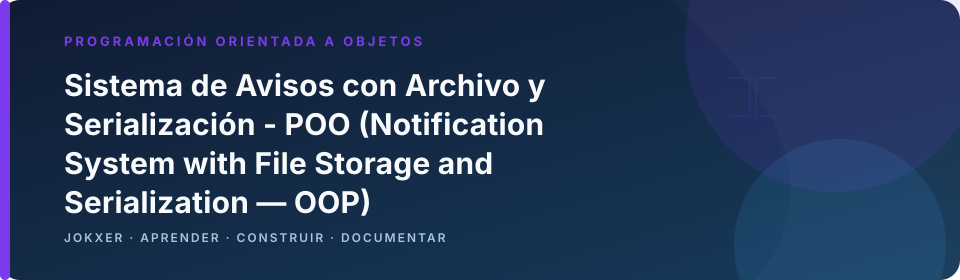

<div align="center">

<h1 align="center"></h1>


</div>

[Inicio](../../README.md) · [Materia](../README.md) · [Desarrollo](desarrollo.md) · [Código](solution.cs)


## En palabras simples


Si un aviso vive solo en memoria, desaparece al cerrar el programa. Guardarlo en un archivo permite recuperarlo después. Serializar significa convertir los datos del objeto a un formato que el programa pueda escribir y volver a leer.

- **¿Por qué?** Los avisos que solo están en memoria desaparecen al cerrar el programa.
- **¿Para qué?** Para producir un reporte TXT legible y un archivo JSON del que el programa pueda recuperar los avisos.
- **¿Cómo?** Registra un aviso, exporta ambos archivos y carga el JSON para comprobar que conserva campos como el título.
- **¿Cuándo usarlo?** Usa TXT para lectura humana y JSON cuando una aplicación tenga que volver a cargar los datos.

## Qué trabajé y cómo leer los ejemplos

Organizo avisos como objetos y guardo su información en archivos. TXT es una representación de texto para lectura; JSON conserva una estructura de campos y valores que puede volver a cargarse. Guardar un archivo y recuperar correctamente sus datos son comprobaciones distintas.

## Planteamiento

Este ejercicio consiste en crear un programa para registrar avisos utilizando programación orientada a objetos.

El sistema permite guardar avisos en memoria, mostrarlos en pantalla, generar un reporte en archivo de texto y serializar la información en formato JSON.

## Objetivo

Aplicar programación orientada a objetos junto con manejo de archivos y serialización de datos.

## Conceptos aplicados

- Clases
- Objetos
- Constructores
- Encapsulación
- Listas
- Menú interactivo
- Manejo de archivos
- Serialización JSON
- Deserialización JSON
- Validación de datos

## Estructura del programa

El programa contiene las siguientes clases:

### Clase `Aviso`

Representa un aviso individual.

Contiene:

- Título
- Mensaje
- Fecha de creación

### Clase `GestorAvisos`

Administra la lista de avisos registrados.

Contiene métodos para:

- Agregar avisos
- Mostrar avisos
- Guardar avisos en un archivo de texto
- Serializar avisos en un archivo JSON
- Deserializar avisos desde un archivo JSON

## Archivos generados

Al ejecutar el programa, se pueden generar los siguientes archivos:

```text
avisos.txt
avisos.json
```

El archivo `avisos.txt` contiene un reporte legible de los avisos.

El archivo `avisos.json` almacena los avisos serializados para poder recuperarlos posteriormente.

## Ejemplo de uso

```text
Sistema de avisos

1. Registrar aviso
2. Mostrar avisos
3. Guardar reporte en archivo TXT
4. Serializar avisos en JSON
5. Cargar avisos desde JSON
0. Salir
Seleccione una opción:
```

## Ejemplo de salida

```text
Avisos registrados:

Título: Reunión académica
Mensaje: Reunión el lunes a las 6:00 p.m.
Fecha: 10/05/2026 18:00
```

## Análisis

Este ejercicio permite comprender cómo una aplicación puede organizar información mediante objetos y conservar los datos usando archivos.

La clase `Aviso` representa la información principal, mientras que la clase `GestorAvisos` se encarga de administrar la colección de avisos y las operaciones de almacenamiento.

## Lenguaje utilizado

C#

---

[Volver a la materia](../README.md) · [Notación y estados](../../GUIA-DE-LECTURA.md)
