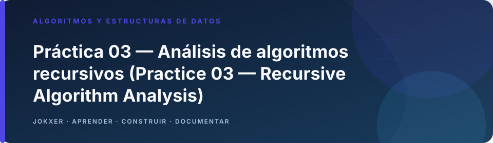

<h1 align="center"></h1>

[Materia 04](../README.md) · [Índice de prácticas](../MATERIALES.md) · [Práctica 02 ←](../practica-02/README.md) · [Práctica 04 →](../practica-04/README.md)

## En palabras simples

Una función recursiva resuelve un problema llamándose con un caso más pequeño hasta que llega a uno que sabe resolver directamente. Sumar de 1 a 3 puede verse como `3 + suma(2)`. El desarrollo publicado es complementario: no existe una entrega original documentada.

- **Suma recursiva:** quita un número del problema en cada llamada.
- **Búsqueda binaria:** cada llamada se queda con la mitad donde podría estar el valor.
- **Fibonacci ingenuo:** cada llamada abre dos caminos y puede repetir trabajo.

[Ver los tres ejemplos desarrollados](desarrollo.md).

### Suma recursiva

- **¿Por qué?** La suma hasta `n` contiene una suma más pequeña.
- **¿Para qué?** Para reconocer una recurrencia con una sola llamada por paso.
- **¿Cómo?** Escribe `suma(3) = 3 + suma(2)` y termina en un caso base como `suma(0) = 0`.
- **¿Cuándo usarlo?** Al aprender a identificar el caso base y la reducción de uno en uno.

### Búsqueda binaria recursiva

- **¿Por qué?** En datos ordenados, una comparación permite ignorar media lista.
- **¿Para qué?** Para reconocer una recurrencia que reduce el tamaño por un factor.
- **¿Cómo?** Compara con el centro y vuelve a llamar solo en la mitad posible; termina al encontrar el valor o vaciar el intervalo.
- **¿Cuándo usarlo?** Al buscar sobre un arreglo ordenado.

### Fibonacci ingenuo

- **¿Por qué?** Las dos ramas de llamadas pueden volver a calcular el mismo valor.
- **¿Para qué?** Para detectar trabajo repetido y distinguirlo de una sola llamada recursiva.
- **¿Cómo?** Dibuja `F(5)` y marca cada aparición de `F(3)`.
- **¿Cuándo usarlo?** Para estudiar el costo de la recursión directa, antes de considerar una forma más eficiente.

## Propósito

Analizar cómo el tamaño del problema y las llamadas recursivas determinan el tiempo y el espacio que utiliza un algoritmo. La actividad conecta el análisis asintótico de las prácticas anteriores con las técnicas de recurrencias de la Práctica 4.

## Mandato localizado

La síntesis disponible indica analizar algoritmos recursivos, identificar el tamaño de entrada y la operación básica, estudiar los casos y formular la relación de recurrencia. No se localizó el enunciado original, por lo que esta descripción no pretende reproducir su redacción literal ni sus ejercicios específicos.

## Desarrollo didáctico complementario

El archivo [desarrollo.md](desarrollo.md) contiene una resolución explicativa elaborada para completar la documentación: suma recursiva, búsqueda binaria y Fibonacci ingenuo. Cada ejemplo identifica la recurrencia, el caso base, la operación básica y las complejidades temporal y espacial.

**Importante:** este desarrollo es material complementario creado para este repositorio; no es una entrega original del estudiante, no reemplaza el documento de la maestra y no se presenta como evidencia de que la práctica se entregó o recibió calificación.

## Resultado de aprendizaje

Al terminar el desarrollo se distingue entre:

- una llamada recursiva que reduce el problema en una unidad;
- una llamada que reduce el tamaño por un factor;
- varias llamadas recursivas por nivel;
- tiempo de ejecución y espacio de la pila;
- mejor caso y peor caso cuando el algoritmo puede terminar antes.

## Estado de la práctica

**Sin entrega original localizada.** La materia se presenta como completada dentro del alcance documental publicado, dejando explícita esta ausencia. La ficha y el desarrollo complementario permiten entender el tema sin atribuir al estudiante una entrega que no presentó.

[Leer el desarrollo complementario](desarrollo.md) · [Volver al índice de prácticas](../MATERIALES.md) · [Volver a la materia](../README.md)
