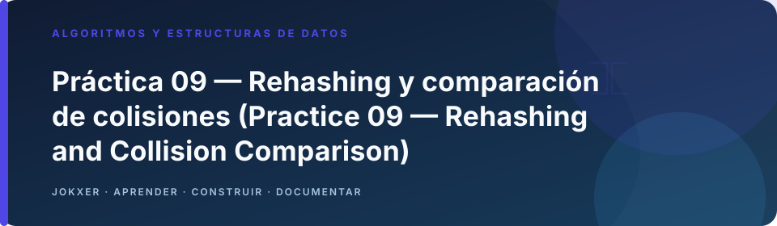

<h1 align="center"></h1>

[Materia 04](../README.md) · [Índice de prácticas](../MATERIALES.md) · [Práctica 08 ←](../practica-08/README.md) ·

## En palabras simples

Cuando una tabla hash se llena, hay más choques. Reubicar las claves al cambiar el tamaño de la tabla es hacer rehashing. Compara qué cambia antes y después, y cómo responde cada método de manejar colisiones.

### Factor de carga

- **¿Por qué?** Una tabla con poco espacio libre puede necesitar más intentos por clave.
- **¿Para qué?** Para medir qué tan llena está y comparar colisiones.
- **¿Cómo?** Divide claves almacenadas entre casilleros: 8 claves en 10 casilleros dan una carga de 0,8.
- **¿Cuándo usarlo?** Al comparar estrategias de colisión con la misma cantidad de datos.

### Rehashing

- **¿Por qué?** Mover claves sin recalcular su ubicación puede hacerlas difíciles de encontrar.
- **¿Para qué?** Para recuperar margen de trabajo sin perder claves vigentes.
- **¿Cómo?** Crea la tabla nueva y reinserta las claves con el tamaño y la regla de colisiones nuevos.
- **¿Cuándo usarlo?** Cuando la carga supera el umbral de la implementación, no cada vez que hay un choque.

## Propósito

Explicar cuándo conviene redimensionar una tabla y cómo la carga y el método de sondeo influyen en las colisiones.

## Mandato

La actividad aborda rehashing con sondeo lineal, doble hashing y encadenamiento, y compara colisiones con sondeo cuadrático bajo distintos factores de carga.

## Qué se trabaja

Comparación de estrategias de reubicación y encadenamiento al cambiar el tamaño de la tabla.

## Qué aporta esta actividad

Explicar cuándo conviene redimensionar una tabla y cómo la carga y el método de sondeo influyen en las colisiones. El aprendizaje esperado es razonar sobre el método y justificar el resultado, no solo registrar una respuesta. Esta ficha enlaza el material disponible y señala sus límites para que se entienda qué permite comprobar.

## Entrega

[Abrir entrega PDF](entrega.pdf)

## Estado de revisión

El PDF está disponible; los resultados matemáticos o tabulares requieren revisión directa para ser declarados verificados.

La carpeta documenta el tema y la evidencia localizada. No se dispone aquí de una comprobación independiente de cada paso ni de la calificación de la actividad.

[Volver al índice de prácticas](../MATERIALES.md) · [Volver a la materia](../README.md)
