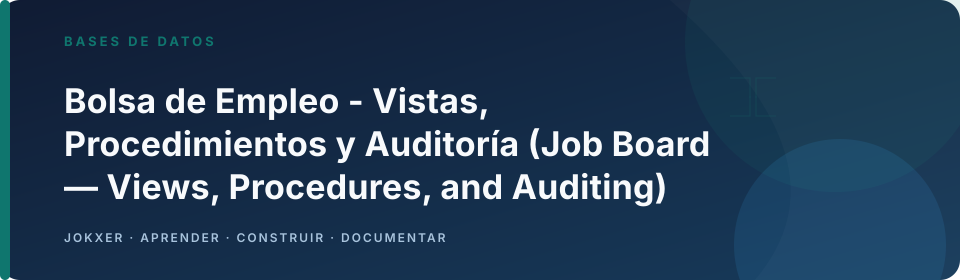

<div align="center">

<h1 align="center"></h1>


</div>

[Inicio](../../README.md) · [Materia](../README.md) · [Desarrollo](desarrollo.md) · [Código](solution.sql) · [Evidencia](caso-bolsa-empleo.pdf)


## En palabras simples


Una vista guarda una forma de consultar datos. Un procedimiento guarda pasos que puedes ejecutar. El registro de auditoría ayuda a ver qué cambió. La práctica aplica esas tres ideas a un sistema de ofertas y solicitudes de empleo.

### Vista de ofertas

- **¿Por qué?** El mismo reporte puede necesitarse varias veces.
- **¿Para qué?** Para reutilizar una consulta con un nombre.
- **¿Cómo?** Lee la vista semanal para ver cómo agrupa ofertas por empresa y ciudad.
- **¿Cuándo usarlo?** Cuando varias consultas o personas necesitan el mismo resumen.

### Procedimiento y función

- **¿Por qué?** Un reporte con fechas y un cálculo de un valor individual necesitan interfaces distintas.
- **¿Para qué?** Para pedir totales por intervalo y comprobar el formato y dígito de control, sin certificar identidad.
- **¿Cómo?** Pasa fechas al procedimiento mensual; usa la función para obtener el valor de comprobación de un caso.
- **¿Cuándo usarlo?** Cuando el reporte recibe parámetros o hay una regla de cálculo reutilizable.

### Auditoría con triggers

- **¿Por qué?** El dato actual no muestra qué cambió antes.
- **¿Para qué?** Para registrar operaciones en la tabla `Empresa`.
- **¿Cómo?** Observa qué recogen `inserted` y `deleted` en cada evento y cómo se registra en `auditoria_empresa`.
- **¿Cuándo usarlo?** Cuando la base de datos debe dejar un rastro automático de cambios de esa tabla.

## Qué trabajé y cómo leer los ejemplos

Organizo consultas reutilizables y registro cambios mediante objetos SQL. Una vista define una consulta, un procedimiento ejecuta instrucciones con parámetros y un trigger responde a un evento. Para ejecutar estos objetos se necesita el esquema del que dependen.

## Descripción de la actividad

Objetos de base de datos para consultar ofertas y registrar cambios de empresas.

---

## Objetivo

Implementar reportes parametrizados y auditoría de operaciones sobre un esquema de empleo.

---

## Conceptos aplicados

- Vistas.
- Procedimientos almacenados.
- Funciones escalares.
- Triggers.
- Tablas inserted y deleted.
- Agrupación temporal.

---

## Actividad desarrollada

La solución incluye una vista semanal por empresa y ciudad, un procedimiento de totales mensuales, una función de comprobación del dígito de control y tres triggers sobre Empresa. Los cambios quedan registrados en auditoria_empresa.

---

## Ejemplo de análisis y uso

```sql
EXEC dbo.sp_TotalOfertasPorMes
    @fecha_inicio = '2025-01-01',
    @fecha_fin = '2025-12-31';
```

El procedimiento devuelve totales mensuales dentro del intervalo. La función de cédula comprueba formato y dígito de control; no confirma identidad ni asignación oficial.

---

## Archivos de esta carpeta

```text
bolsa-empleo-objetos-sql/
├── README.md
├── desarrollo.md
├── caso-bolsa-empleo.pdf
├── informe-solucion.pdf
└── solution.sql
```

- [caso-bolsa-empleo.pdf](caso-bolsa-empleo.pdf)
- [informe-solucion.pdf](informe-solucion.pdf)
- [solution.sql](solution.sql)

El archivo [desarrollo.md](desarrollo.md) explica las decisiones y el alcance de la solución.

---

## Cómo revisar la actividad

Revisar el caso y preparar antes la base Bolsa_Empleo con sus tablas. Su script de creación no está en esta carpeta. Los supuestos sobre fechas y el límite de YEAR con ISO_WEEK se explican en desarrollo.md.

---

## Relación con los archivos originales

Los enunciados, modelos y documentos de apoyo están relacionados en el [inventario de documentos](../../archivos-originales/bases-de-datos/INVENTARIO.md). Allí se pueden consultar las versiones publicadas y su tratamiento.

## Lenguaje y herramientas

T-SQL para SQL Server.

## Estado

Actividad organizada y documentada como parte del portafolio académico de Bases de Datos. El [registro de validación](../VALIDACION.md) distingue la revisión realizada de las pruebas que requieren SQL Server.

[Volver a Bases de Datos](../README.md)
