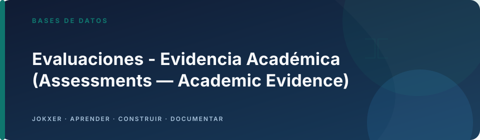

<div align="center">

<h1 align="center"></h1>


</div>

[Inicio](../../README.md) · [Materia](../README.md) · [Desarrollo](desarrollo.md) · [Evidencia](evidencia-primer-parcial.pdf)


## En palabras simples


Esta página indica qué evidencias académicas se conservaron y cómo leerlas. Usa cada archivo para identificar el tema practicado, sin tomar una nota, un enunciado o una evidencia aislada como prueba de que otra solución sea correcta.

## Qué trabajé y cómo leer los ejemplos

Reúno las evidencias de evaluación y los enlaces a las soluciones relacionadas. Las evidencias conservadas corresponden a evaluaciones concretas y no deben interpretarse como nota final de la asignatura.

## Descripción de la actividad

Respaldo del primer parcial y referencia al segundo parcial resuelto.

---

## Objetivo

Relacionar las evaluaciones conservadas con las competencias expuestas en los trabajos.

---

## Conceptos aplicados

- Diseño relacional.
- Razonamiento de bases de datos.
- SQL.
- Evidencia documental.

---

## Actividad desarrollada

Se conserva la prueba escaneada y su captura de retroalimentación. La segunda prueba y sus consultas se presentan en la actividad de restaurante. La evidencia del primer parcial se conserva como respaldo de esa evaluación y no como indicador de la nota final de la asignatura.

---

## Ejemplo de análisis

Los trabajos de coches permiten revisar claves y relaciones, y la actividad de restaurante permite contrastar las consultas del segundo parcial.

---

## Archivos de esta carpeta

```text
evaluaciones-evidencia-academica/
├── README.md
├── desarrollo.md
├── calificacion-primer-parcial.png
└── evidencia-primer-parcial.pdf
```

- [calificacion-primer-parcial.png](calificacion-primer-parcial.png)
- [evidencia-primer-parcial.pdf](evidencia-primer-parcial.pdf)

El archivo [desarrollo.md](desarrollo.md) explica las decisiones y el alcance de la solución.

---

## Cómo revisar la actividad

Revisar el primer parcial y la captura; después consultar [Restaurante - Consultas del Segundo Parcial](../restaurante-consultas-segundo-parcial/README.md).

---

## Relación con los archivos originales

Los enunciados, modelos y documentos de apoyo están relacionados en el [inventario de documentos](../../archivos-originales/bases-de-datos/INVENTARIO.md). Allí se pueden consultar las versiones publicadas y su tratamiento.

## Lenguaje y herramientas

Evidencia documental en PDF e imagen.

## Estado

Actividad organizada y documentada como parte del portafolio académico de Bases de Datos. El [registro de validación](../VALIDACION.md) distingue la revisión realizada de las pruebas que requieren SQL Server.

[Volver a Bases de Datos](../README.md)
