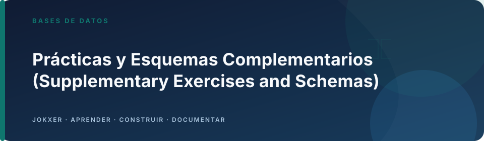

<h1 align="center"></h1>

[Inicio](../../README.md) · [Materia](../README.md) · [Desarrollo](desarrollo.md) · [Código](.) · [Evidencia](guia-estudio-bookstore.pdf)

## En palabras simples

**Bookstore:** usa el diagrama para seguir cómo se relacionan los datos de la librería. **Fast Food:** sigue los datos de un pedido en su esquema. **Hospital:** localiza qué tablas guardan datos de cada parte del sistema. Lee las claves para saber cómo unir la información.

### Bookstore

- **¿Por qué?** Un pedido puede incluir varios libros.
- **¿Para qué?** Para practicar consultas de cabecera y detalle en un caso de librería.
- **¿Cómo?** Sigue en el diagrama las claves que conectan cliente, pedido, detalle y libro.
- **¿Cuándo usarlo?** Cuando necesites entender cómo se reconstruye un pedido a partir de varias tablas.

### Fast Food

- **¿Por qué?** Los datos de un pedido no tienen por qué estar en una sola tabla.
- **¿Para qué?** Para practicar cómo ubicar cada dato antes de escribir una consulta.
- **¿Cómo?** Abre el esquema de práctica y sigue las referencias del pedido hacia sus datos relacionados.
- **¿Cuándo usarlo?** Al estudiar consultas sobre pedidos usando ese esquema independiente.

### Hospital

- **¿Por qué?** No conviene unir tablas solo porque sus columnas tienen nombres parecidos.
- **¿Para qué?** Para practicar lectura de relaciones antes de cruzar datos.
- **¿Cómo?** Identifica tablas y claves declaradas en el esquema de hospital y comprueba cómo se relacionan.
- **¿Cuándo usarlo?** Cuando recibes un esquema ajeno y necesitas entenderlo sin mezclarlo con otros casos.

## Qué trabajé y cómo leer los ejemplos

Reúno esquemas de apoyo para practicar la lectura de tablas y relaciones. Librería, hospital y comida rápida son casos independientes. Sus tablas no deben combinarse en una sola base de datos sin revisar primero los nombres y las dependencias.

## Descripción de la actividad

Material de estudio y esquemas de librería, hospital y comida rápida conservados en la asignatura.

---

## Objetivo

Relacionar estructuras de ejemplo con consultas, restricciones y conceptos utilizados en las evaluaciones.

---

## Conceptos aplicados

- Lectura de esquemas relacionales.
- Claves primarias y foráneas.
- SQL Server.
- Consultas y objetos de base de datos.
- Material de estudio.

---

## Actividad desarrollada

BOOKSTORE organiza autores, editoriales, libros, clientes, pedidos y detalles. La guía DB2 explica consultas sobre ese caso y se identifica como material de repaso, no como una evaluación adicional realizada. Hospital y comida rápida son exportaciones de esquemas de práctica: se conservan como apoyo y no se atribuye su autoría original al alumno.

---

## Archivos de esta carpeta

- [bookstore.sql](bookstore.sql).
- [diagrama-bookstore.png](diagrama-bookstore.png).
- [fast-food.sql](fast-food.sql).
- [guia-estudio-bookstore.docx](guia-estudio-bookstore.docx).
- [guia-estudio-bookstore.pdf](guia-estudio-bookstore.pdf).
- [hospital.sql](hospital.sql).
- [Desarrollo y análisis](desarrollo.md).

---

## Cómo revisar la actividad

Ejecutar cada esquema en una base independiente de práctica. BOOKSTORE crea su base; hospital.sql requiere una base hospital y fast-food.sql una base FASTFOOD_grupo5 ya creadas. Las opciones de las exportaciones pueden requerir una versión compatible de SQL Server. Revisar la guía antes de reproducir sus consultas.

---

## Relación con los archivos originales

Los modelos y documentos de apoyo se encuentran en el [inventario de documentos](../../archivos-originales/bases-de-datos/INVENTARIO.md), junto con las versiones publicadas y sus adaptaciones.

## Estado

Material de apoyo organizado y documentado.

[Volver a Bases de Datos](../README.md)
