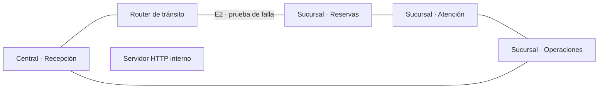

# Cadena hotelera · Red multisede con RIPv2

[Fundamentos de Redes](../README.md) · [Plan de direccionamiento y pruebas](validacion.md)

## En palabras simples

Si solo hay un camino entre Recepción y Reservas, un corte puede dejarlas aisladas. En el simulador, el equipo unió las sedes en un anillo y comprobó que era posible llegar por el otro lado cuando se cortaba el enlace habitual.

## Necesidad

La central aloja un sitio HTTP interno para consultar disponibilidad y llegadas. Operaciones, Reservas y Atención al huésped necesitan acceder desde sus propias redes. El diseño parte de **76 terminales de referencia**; esa cifra dimensiona el caso y no es el número de equipos probados simultáneamente.

## Diseño

En el escenario normal, el tráfico entre la central y Reservas atraviesa Tránsito. Con **E2** fuera de servicio, el informe documenta la ruta alternativa esperada por Operaciones y Atención. La traza durante la transición retiene un salto de Tránsito; la tabla de rutas al restablecer E2 vuelve a mostrar Tránsito como siguiente salto. El equipo pasó de una etapa estática acotada a RIPv2 en los cinco routers. Se dimensionaron las subredes con VLSM y la prueba de IPv6 se limitó a Reservas.

## Contribución y evidencia

Trabajo académico en equipo. Según la planificación del informe, mi contribución incluye diseño de topología y diagramas, montaje y configuración inicial, direccionamiento, etapa estática y migración a RIPv2; las pruebas de IPv6 y recuperación se realizaron en equipo. No se atribuye a una sola persona el plan VLSM, presupuesto ni informe.

**Nivel: validado en simulación, según la entrega original.** La [matriz de pruebas](validacion.md) distingue resultados reportados, cálculos y límites. El anillo protege frente a un corte simple del enlace en este diseño, no frente a la pérdida del servidor ni a dos cortes. No se verificó producción, una ventana garantizada de recuperación ni capacidad simultánea de las 76 terminales.

## Informe y capturas

- [Informe público del proyecto (PDF)](documentos/informe-publico-cadena-hotelera.pdf): alcance, diseño, dimensionamiento y resultados.
- [Evidencia visual de la entrega (PDF)](documentos/evidencia-original-cadena-hotelera.pdf): páginas 9, 10, 12 y 16–20 del informe de clase, con diagramas, tabla VLSM, salidas de consola y capturas de Packet Tracer. Se excluyen las páginas con datos personales y credenciales.

**Autores del trabajo:** Kelvin César Del Castillo Torres y Gabriel Galasso.

[Ver la carpeta de documentos del proyecto](documentos/README.md).

[Descargar el simulador de la entrega](documentos/cadena-hotelera.pkt).
