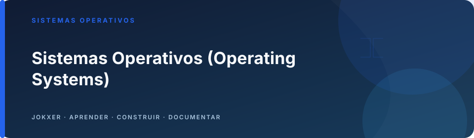

<h1 align="center"></h1>

[Inicio](../README.md) · **Materia 08** · [Índice de materias](../README.md#áreas-principales) · [Pendientes](../PENDIENTES.md)

## Presentación

Esta sección reúne el programa de **ISC-364 Sistemas Operativos I**, las tareas individuales documentadas y una síntesis de los proyectos realizados durante la asignatura. La organización sigue el recorrido de los temas disponible en la carpeta de estudio y distingue entre evidencia publicada, material de consigna y actividades sin PDF encontrado.

El portafolio explica qué conceptos estudié, qué operaciones se solicitaron y qué competencias se pueden respaldar con los documentos disponibles. Los enlaces a las entregas conservan sus contenidos originales; los nombres publicados se normalizaron para que el tema y el tipo de actividad se identifiquen con claridad. La materia queda completada dentro del alcance documental publicado: las evidencias disponibles están organizadas y las actividades sin PDF localizado se identifican expresamente.

## Navegación

- [Programa de estudio y alcance](programa-estudio/README.md)
- [Material docente y guías de instalación](material-docente/README.md)
- [Competencias y logros documentados](competencias/README.md)
- [Actividades y tareas](actividades/README.md)
- [Proyectos y contribuciones](proyectos/README.md)
- [Evidencias PDF](evidencias/README.md)
- [Fuentes y criterios de publicación](referencias/README.md)

## Material de estudio

Se publican las presentaciones de los capítulos 1, 2 y 4, además de dos guías PDF sobre imágenes de sistemas operativos e instalación de Windows 10 en VirtualBox. Consulta el [índice de material docente](material-docente/README.md).

## Recorrido de aprendizaje

| Bloque | Temas | Actividades relacionadas |
|---|---|---|
| 1. Fundamentos | Funciones, estructura y componentes de un sistema operativo | [Tarea 1](actividades/tarea-01/README.md) |
| 2. Virtualización | Máquinas virtuales, hipervisores y nube | [Tarea 2](actividades/tarea-02/README.md) |
| 3. Sistemas de escritorio | Instalación de Windows, particiones y cuentas | [Tareas 3 y 4](actividades/tarea-03/README.md) · [Tarea 4](actividades/tarea-04/README.md) |
| 4. Interacción y automatización | Shell, intérpretes de mandatos y scripts | [Tarea 4 y proyecto grupal](actividades/tarea-04/README.md) |
| 5. Gestión y protección | Grupos, copias de seguridad, antivirus, firewall, actualizaciones y cifrado | [Tareas 5–9](actividades/tarea-05/README.md) · [Tarea 7](actividades/tarea-07/README.md) · [Tarea 8](actividades/tarea-08/README.md) · [Tarea 9](actividades/tarea-09/README.md) |
| 6. Otros sistemas | Sistemas móviles, macOS y Linux | [Tarea 10](actividades/tarea-10/README.md) · [Tarea 11](actividades/tarea-11/README.md) |
| 7. Recursos del sistema | Respaldo, sistemas de archivos y memoria | [Tareas 12–14](actividades/tarea-12/README.md) · [Tarea 13](actividades/tarea-13/README.md) · [Tarea 14](actividades/tarea-14/README.md) |
| 8. Administración de servidores | Windows Server, TCP/IP, DNS, DHCP y Active Directory | [Tareas 15–17](actividades/tarea-15/README.md) · [Tarea 16](actividades/tarea-16/README.md) · [Tarea 17](actividades/tarea-17/README.md) |

## Competencias reflejadas en las evidencias

- Explicar la función del sistema operativo como intermediario entre aplicaciones, usuarios y hardware.
- Describir la virtualización y documentar la preparación de máquinas virtuales.
- Documentar procesos de instalación y configuración básica de Windows, Linux y macOS en entornos virtualizados.
- Interpretar el uso del Shell y preparar scripts introductorios para automatizar tareas.
- Reconocer prácticas de respaldo, administración de usuarios, grupos y protección del sistema.
- Explicar sistemas de archivos, uso del almacenamiento y memoria virtual.
- Describir servicios de Windows Server y documentar conceptos de direccionamiento, DNS, DHCP y Active Directory.

Las competencias se presentan como aprendizajes respaldados por tareas y proyectos; la carpeta de estudio no incluye calificaciones ni constancias de evaluación para cada entrega.

## Estado de las evidencias

Se localizaron 25 PDF individuales de tareas y un PDF del programa de la asignatura. Las tareas 5 y 6 tienen consignas o documentos editables, pero no se encontró un PDF final en la carpeta revisada. Por eso aparecen identificadas como evidencia PDF no localizada, sin afirmar que no se realizaron.

Los nombres publicados corrigen inconsistencias de nomenclatura y se basan en el tema de cada documento. Los archivos PDF no se editaron; cuando el encabezado interno tiene una numeración distinta, la página de la actividad lo deja indicado.

## Proyectos

La carpeta documenta dos trabajos colaborativos con componentes de sistemas operativos: una exposición sobre Shell y scripts en Windows, y **NEXO Linux**, centrado en preparar una máquina virtual y modificar, compilar y comprobar un kernel Linux. [Ver contribuciones y alcance](proyectos/README.md).

## Criterios de documentación

- Se conserva el sentido académico de cada entrega y se separan teoría, práctica y proyectos.
- Los PDF enlazados son los archivos de evidencia existentes; no se inventan capturas, ejecuciones ni resultados.
- Los resúmenes y competencias se redactan para describir el trabajo y su aprendizaje, con referencias a las fuentes utilizadas.
- No se distribuyen los libros completos de terceros. Los recursos audiovisuales se citan o enlazan.
- Los materiales grupales se describen distinguiendo la contribución individual y evitando publicar datos personales de otros integrantes.

[Volver al índice general](../README.md)
