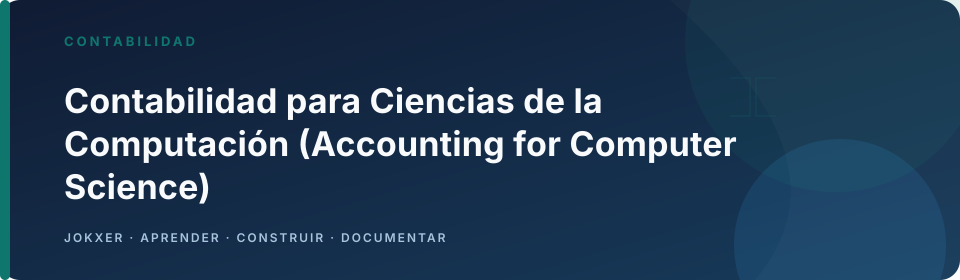

<h1 align="center"></h1>

[Inicio](../README.md) · **Materia 14** · [Índice de materias](../README.md#áreas-principales) · [Pendientes](../PENDIENTES.md)

Materia planificada en el orden académico. El contenido se incorporará cuando esté disponible.

## En palabras simples

Esta página indica en qué punto de la ruta académica está la materia. Todavía no hay ejercicios ni entregas publicados en esta sección. Si quieres seguir estudiando, vuelve al [índice de materias](../README.md#áreas-principales).

## Estado

**Pendiente.** Esta carpeta establece la posición y el nombre de la materia en el recorrido académico. El material se incorporará posteriormente.
