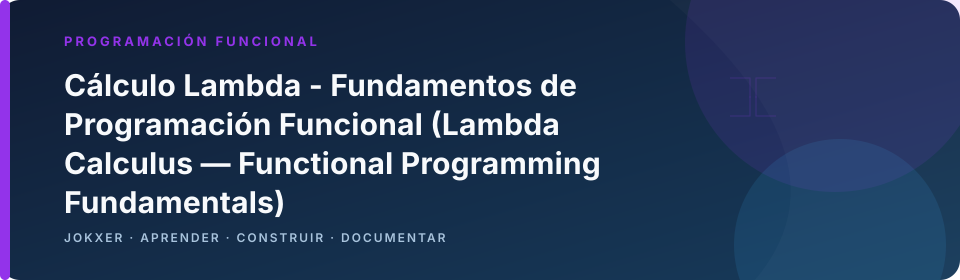

<div align="center">

<h1 align="center"></h1>


</div>

[Inicio](../../README.md) · [Materia](../README.md) · [Desarrollo](desarrollo.md) · [Evidencia](actividad-calculo-lambda-fundamentos.pdf)


## En palabras simples


Una función recibe algo y devuelve un resultado. En cálculo lambda practicas reemplazar una variable por el argumento: si la regla dice `x + 1` y das `4`, obtienes `5`. El orden de las sustituciones y los nombres de las variables importan.

### Ejercicios de esta carpeta, uno por uno

- [Ejercicio 1.1](desarrollo.md#ejercicio-11): Identifica el parámetro y luego la parte donde se usa; eso te da el primer nivel del árbol.
- [Ejercicio 1.2](desarrollo.md#ejercicio-12): Dibuja una aplicación arriba y las dos funciones como sus ramas.
- [Ejercicio 1.3](desarrollo.md#ejercicio-13): Sigue las funciones que aparecen una dentro de otra antes de separar la aplicación final.
- [Ejercicio 2.1](desarrollo.md#ejercicio-21): Cambia solo la variable libre que pide el ejercicio; renombra un parámetro para evitar que se confundan los nombres.
- [Ejercicio 2.2](desarrollo.md#ejercicio-22): No reemplaces una letra dentro de la función que la declara como su parámetro.
- [Ejercicio 2.3](desarrollo.md#ejercicio-23): Renombra el parámetro antes de introducir una variable libre con el mismo nombre.
- [Ejercicio 3.1](desarrollo.md#ejercicio-31): Busca una aplicación que se pueda simplificar y anota el resultado de cada paso.
- [Ejercicio 3.2](desarrollo.md#ejercicio-32): Sigue las aplicaciones en su orden y comprueba si todavía se puede simplificar alguna.
- [Ejercicio 3.3](desarrollo.md#ejercicio-33): Distingue el resultado que puede seguir reduciéndose del que ya llegó a su forma normal.

## Qué trabajé y cómo leer los ejemplos

Estudio funciones mediante variables, abstracción y aplicación. En λx.x, λ introduce una función y x es su parámetro. La aplicación (λx.x) 5 se reduce a 5 por sustitución; el símbolo λ no representa una constante numérica.

## Descripción de la actividad

Esta actividad trabaja conceptos fundamentales del cálculo lambda, una base teórica importante para comprender la programación funcional.

El ejercicio incluye la construcción de árboles de sintaxis, sustituciones y reducciones beta para obtener formas normales de expresiones lambda.

---

## Objetivo

Comprender la estructura y evaluación de expresiones lambda mediante:

- Representación de λ-términos.
- Construcción de árboles de sintaxis.
- Sustitución de variables.
- Aplicación de reducciones beta.
- Obtención de formas normales.

---

## Conceptos aplicados

- Cálculo lambda.
- Programación funcional.
- Abstracción lambda.
- Variables libres y ligadas.
- Aplicación de funciones.
- Sustitución.
- Reducción beta.
- Forma normal.
- Árboles de sintaxis.

---

## Importancia en Programación Funcional

El cálculo lambda permite entender cómo se representan y evalúan las funciones en los lenguajes funcionales.

Aunque esta actividad no contiene código directamente en SML, fortalece los fundamentos necesarios para trabajar con funciones, recursividad, patrones, listas y evaluación de expresiones en Standard ML.

---

## Contenido de la actividad

La práctica se divide en tres partes:

1. Dibujar árboles de sintaxis de λ-términos.
2. Realizar sustituciones en expresiones lambda.
3. Aplicar reducciones beta para obtener formas normales.

---

## Archivos de esta carpeta

```text
calculo-lambda-fundamentos/
├── README.md
├── desarrollo.md
└── actividad-calculo-lambda-fundamentos.pdf
```

El archivo `README.md` presenta la actividad de forma general.

El archivo `desarrollo.md` contiene una versión organizada y explicada del desarrollo de la actividad.

El archivo `actividad-calculo-lambda-fundamentos.pdf` conserva la evidencia documental de la práctica original.

---

## Relación con los archivos originales

El documento original de la actividad también se conserva como respaldo académico en:

```text
archivos-originales/programacion-funcional-sml/
```

Esta carpeta contiene una versión organizada y profesional del desarrollo, mientras que la carpeta de archivos originales conserva la evidencia académica inicial.

---

## Nota sobre datos personales

El PDF complementa la explicación y permite consultar el planteamiento académico de la actividad.

En caso de que el documento original contenga datos personales, se debe subir una versión limpia o censurada.

---

## Estado

Actividad organizada y documentada como parte del portafolio académico de Programación Funcional-SML.

---

[Volver a la materia](../README.md) · [Notación y estados](../../GUIA-DE-LECTURA.md)
