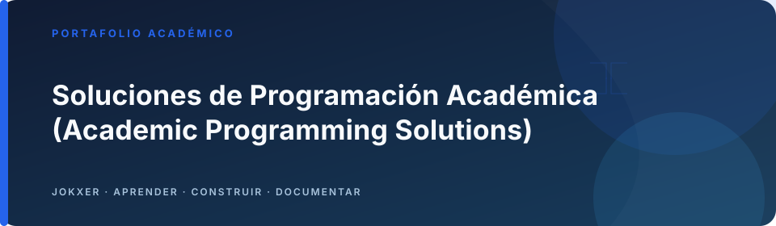

<div align="center">

<h1 align="center"></h1>

### Programación, sistemas y datos · Ruta 00–15

Recorre las materias en orden y encuentra el código, las explicaciones y las evidencias disponibles.


[🎓 Ruta académica](#áreas-principales) · [🧪 Proyectos](#proyectos-destacados) · [📖 Guía](GUIA-DE-LECTURA.md) · [📍 Pendientes](PENDIENTES.md)

</div>

Soy Kelvin César Del Castillo Torres, estudiante de Ingeniería en Ciencias de la Computación en la **Pontificia Universidad Católica Madre y Maestra (PUCMM)**. Aquí reúno soluciones, actividades y proyectos que documentan mi aprendizaje.

El portafolio reúne materias cursadas con actividades y fuentes académicas documentadas, además de materias planificadas en estado pendiente. Explico cómo abordé los problemas, conservo las entregas disponibles y distingo las revisiones nuevas de los trabajos originales. Las materias 08 y 10 reúnen programas de estudio, evidencias, actividades, proyectos y competencias; ambas se consideran completadas dentro del alcance documental publicado.

---

## En palabras simples


Si estás aprendiendo, elige una materia y abre una actividad. Empieza por **En palabras simples** para entender qué se busca y sigue al código, al desarrollo o a la evidencia cuando quieras más detalle. En las carpetas que reúnen varios ejercicios, puedes leerlos uno por uno.

## Elige tu ruta

| Ruta | Empieza por |
|---|---|
| 🎓 **Aprender en secuencia** | [Índice 00–15](#áreas-principales) y [guía de lectura](GUIA-DE-LECTURA.md). |
| 🧪 **Revisar pruebas y código** | [C++ en Windows](https://github.com/jokxer8/soluciones-programacion-academica/actions/runs/43634987168) y [C/FASM en Linux](https://github.com/jokxer8/soluciones-programacion-academica/actions/runs/43634987047). |
| 💼 **Evaluar un proyecto** | [Reservas de Hotel](06-bases-de-datos/hotel-reservas-proyecto-final) y [Gestión de países](02-fundamentos-sistemas-computacionales/proyecto-final-paises). |

**Indicador documental:** 11 de 16 materias completadas dentro del alcance publicado; 5 pendientes. Las ejecuciones enlazadas cubren solo los ejercicios correspondientes. La sección «En palabras simples» mide cobertura editorial, no ejercicios ejecutados ni resultados de aprendizaje medidos.

## Explorar el portafolio

[Materias y estados](#áreas-principales) · [Proyectos destacados](#proyectos-destacados) · [Evidencias originales](archivos-originales) · [Pendientes](PENDIENTES.md) · [Perfil del autor](https://github.com/jokxer8) · [Guía de presentación](GUIA-DE-ESTILO.md)

**Ruta de aprendizaje**

[00 · Introducción a la Algoritmia](00-introduccion-a-la-algoritmia) → [01 · Fundamentos de Programación](01-fundamentos-programacion) → [02 · Fundamentos de Sistemas Computacionales](02-fundamentos-sistemas-computacionales) → [03 · Programación Orientada a Objetos](03-programacion-orientada-a-objetos) → [04 · Algoritmos Clásicos y Estructuras de Datos](04-algoritmo-clasico-y-estructura-de-datos) → [05 · Diseño y Análisis de Algoritmos](05-diseno-y-analisis-de-algoritmos) → [06 · Bases de Datos](06-bases-de-datos) → [07 · Fundamentos de Redes](07-fundamentos-de-redes)

[08 · Sistemas Operativos](08-sistemas-operativos) → [09 · Inteligencia de Negocios](09-inteligencia-de-negocios) → [10 · Introducción a la Ingeniería de Software](10-introduccion-a-la-ingenieria-de-software) → [11 · Arquitectura de Software](11-arquitectura-de-software) → [12 · Programación Web](12-programacion-web) → [13 · Introducción a la Inteligencia Artificial](13-introduccion-a-la-inteligencia-artificial) → [14 · Contabilidad para Ciencias de la Computación](14-contabilidad-para-ciencias-de-la-computacion) → [15 · Programación Funcional-SML](15-programacion-funcional-sml)

Cada actividad conecta **enunciado → desarrollo → código → evidencia**. Las pruebas y sus límites se documentan en la materia correspondiente.

---

## Objetivo del repositorio

Presentar de forma profesional una selección de ejercicios y actividades académicas organizadas por áreas de aprendizaje, acompañadas de explicaciones, análisis, documentación y código fuente limpio.

El código y los documentos permiten seguir mi práctica con distintos paradigmas de programación. Cuando hay pruebas ejecutadas, enlazo sus resultados y explico sus límites. Los enunciados que todavía no tienen solución se identifican como pendientes.

---

## Áreas principales

| Área | Descripción | Estado |
|---|---|---|
| [00 - Introducción a la Algoritmia](00-introduccion-a-la-algoritmia) | Primeros algoritmos, diagramas, C++, ciclos, búsqueda de texto y actividades introductorias. | Completado |
| [01 - Fundamentos de Programación](01-fundamentos-programacion) | Lectura de datos, variables, condicionales, ciclos, arreglos, cadenas y métodos. | Completado |
| [02 - Fundamentos de Sistemas Computacionales](02-fundamentos-sistemas-computacionales) | Representación de datos, C, FASM/NASM, memoria, listas, colas, pilas y proyecto de países. | Completado |
| [03 - Programación Orientada a Objetos](03-programacion-orientada-a-objetos) | Clases, objetos, herencia, polimorfismo, archivos y serialización. | Completado |
| [04 - Algoritmos Clásicos y Estructuras de Datos](04-algoritmo-clasico-y-estructura-de-datos) | Nueve fichas, mandatos, entregas disponibles, desarrollo didáctico complementario para la Práctica 3 y dos proyectos. La entrega original de la Práctica 3 no fue presentada. | Completado |
| [05 - Diseño y Análisis de Algoritmos](05-diseno-y-analisis-de-algoritmos) | Recursividad, búsqueda, ordenamiento, programación dinámica, grafos y complejidad. | Completado |
| [06 - Bases de Datos](06-bases-de-datos) | Modelado, normalización, consultas SQL y proyecto de hotel. | Completado |
| [07 - Fundamentos de Redes](07-fundamentos-de-redes) | Quince fichas, configuración IOS, direccionamiento, rutas estáticas, TCP/UDP y proyecto de red multisede con RIPv2. | Completado |
| [08 - Sistemas Operativos](08-sistemas-operativos) | Programa, tareas teóricas y prácticas; exposición de Shell y proyecto NEXO Linux con kernel personalizado y syscall comprobada. | Completado |
| [09 - Inteligencia de Negocios](09-inteligencia-de-negocios) | Materia planificada; contenido pendiente. | Pendiente |
| [10 - Introducción a la Ingeniería de Software](10-introduccion-a-la-ingenieria-de-software) | Programa, ocho presentaciones de apoyo, tres PDF propios, proyectos, competencias y simulador de práctica; las evidencias de evaluación se excluyen. | Completado |
| [11 - Arquitectura de Software](11-arquitectura-de-software) | Materia planificada; contenido pendiente. | Pendiente |
| [12 - Programación Web](12-programacion-web) | Materia planificada; contenido pendiente. | Pendiente |
| [13 - Introducción a la Inteligencia Artificial](13-introduccion-a-la-inteligencia-artificial) | Materia planificada; contenido pendiente. | Pendiente |
| [14 - Contabilidad para Ciencias de la Computación](14-contabilidad-para-ciencias-de-la-computacion) | Materia planificada; contenido pendiente. | Pendiente |
| [15 - Programación Funcional-SML](15-programacion-funcional-sml) | Programación funcional, cálculo lambda, tipos, árboles, módulos y listas perezosas. | Completado |
| [Archivos originales](archivos-originales) | Materiales académicos originales conservados como referencia. | Completado |

---

## Estructura general del repositorio

Las carpetas numeradas siguen el orden académico. Las materias sin contenido están marcadas como pendientes; las materias documentadas enlazan a sus índices y evidencias.

```text
00-introduccion-a-la-algoritmia/
01-fundamentos-programacion/
02-fundamentos-sistemas-computacionales/
03-programacion-orientada-a-objetos/
04-algoritmo-clasico-y-estructura-de-datos/ (materiales organizados; actividades en documentación)
05-diseno-y-analisis-de-algoritmos/
06-bases-de-datos/
07-fundamentos-de-redes/ (actividades, caso multisede y evidencias resumidas)
08-sistemas-operativos/ (programa, actividades, evidencias y proyectos)
09-inteligencia-de-negocios/ (pendiente)
10-introduccion-a-la-ingenieria-de-software/ (programa, material docente, actividades, proyectos y recursos)
11-arquitectura-de-software/ (pendiente)
12-programacion-web/ (pendiente)
13-introduccion-a-la-inteligencia-artificial/ (pendiente)
14-contabilidad-para-ciencias-de-la-computacion/ (pendiente)
15-programacion-funcional-sml/
```

---

## Ejercicios y actividades destacadas

### Fundamentos de Sistemas Computacionales

| Actividad | Conceptos principales |
|---|---|
| [Representación de datos y fundamentos](02-fundamentos-sistemas-computacionales/fundamentos-representacion-datos) | Sistemas de numeración, complemento a dos, IEEE 754 y tamaños de tipos. |
| [Programación en C y ensamblador FASM](02-fundamentos-sistemas-computacionales/c-y-ensamblador) | Doce ejercicios equivalentes de entrada/salida, decisiones, ciclos, primos y patrones. |
| [Estructuras y memoria dinámica](02-fundamentos-sistemas-computacionales/estructuras-y-memoria) | Diez ejercicios de estructuras, punteros, rectángulos, complejos y listas. |
| [Listas, colas y pilas](02-fundamentos-sistemas-computacionales/listas-colas-pilas) | Diecinueve ejercicios de búsqueda, agregación, eliminación, ordenamiento, FIFO y LIFO. |
| [Proyecto híbrido C y NASM](02-fundamentos-sistemas-computacionales/proyecto-hibrido-c-nasm) | Interoperabilidad C/ensamblador x64 para sumar, ordenar e intercambiar enteros. |
| [Gestión de países — Proyecto final](02-fundamentos-sistemas-computacionales/proyecto-final-paises) | Lista doblemente enlazada con nodo cabecera, carga CSV, consultas, inserciones, eliminación y cuatro criterios de ordenamiento. |

---

### Introducción a la Algoritmia

| Actividad | Conceptos principales |
|---|---|
| [Fundamentos de algoritmia](00-introduccion-a-la-algoritmia/fundamentos-algoritmia) | Problemas, algoritmos y su relación con los programas. |
| [Triángulo rectángulo](00-introduccion-a-la-algoritmia/triangulo-rectangulo) | Hipotenusa, área, perímetro y comparación entre pseudocódigo, RAPTOR y C++. |
| [Pirámide de asteriscos](00-introduccion-a-la-algoritmia/piramide-asteriscos) | Validaciones, ciclos anidados y patrones. |
| [Coincidencias en un texto](00-introduccion-a-la-algoritmia/busqueda-coincidencias-texto) | Cadenas, búsqueda y coincidencias superpuestas. |
| [Diagramas secuenciales](00-introduccion-a-la-algoritmia/ejercicios-secuenciales) | Asignaciones y seguimiento de variables. |
| [Fibonacci y corrida manual](00-introduccion-a-la-algoritmia/fibonacci-traza) | Ciclos y actualización de variables. |
| [Primer parcial](00-introduccion-a-la-algoritmia/enunciados-primer-parcial) | Dos soluciones nuevas de comisiones y calificaciones, separadas de la entrega original. |

Los cinco programas originales C++ cuentan con **32 casos correctos y 0 fallidos**; la batería ampliada incorpora otros 21 casos para las dos soluciones nuevas del parcial en la [validación de Windows](00-introduccion-a-la-algoritmia/VALIDACION.md). El [triángulo en RAPTOR](00-introduccion-a-la-algoritmia/triangulo-rectangulo/PRUEBAS-RAPTOR.md) incluye el fallo observado en el original, la corrección y siete casos numéricos comprobados.

---

### Fundamentos de Programación

| Ejercicio | Conceptos principales |
|---|---|
| [Estadísticas básicas de un arreglo](01-fundamentos-programacion/estadisticas-basicas-arreglo) | Arreglos, ciclos, métodos, suma, promedio, mayor y menor |
| [Clasificación de números](01-fundamentos-programacion/clasificacion-numeros) | Condicionales, contadores, acumuladores y operador módulo |
| [Análisis de cadena de texto](01-fundamentos-programacion/analisis-cadena-texto) | Cadenas, caracteres, métodos y validaciones |
| [Calculadora con menú](01-fundamentos-programacion/calculadora-menu) | Menú interactivo, métodos, ciclos y operaciones matemáticas |
| [Búsqueda secuencial](01-fundamentos-programacion/busqueda-secuencial-arreglo) | Arreglos, búsqueda lineal, validación y recorrido secuencial |

---

### Programación Orientada a Objetos

| Ejercicio | Conceptos principales |
|---|---|
| [Teléfono móvil POO](03-programacion-orientada-a-objetos/telefono-movil-poo) | Clases, objetos, composición, propiedades y métodos |
| [Matriz 2x2 POO](03-programacion-orientada-a-objetos/matriz-2x2-poo) | Clases, constructores, determinante, inversa y validación |
| [Agenda de citas POO](03-programacion-orientada-a-objetos/agenda-citas-poo) | Enumeraciones, listas, objetos, validaciones y excepciones |
| [Avisos con archivo y serialización](03-programacion-orientada-a-objetos/avisos-archivo-serializacion-poo) | Archivos, listas, JSON, serialización y deserialización |
| [Sistema de nómina con polimorfismo](03-programacion-orientada-a-objetos/sistema-nomina-polimorfismo-poo) | Abstracción, herencia, clases abstractas, sobrescritura y polimorfismo |

---

### Algoritmos Clásicos y Estructuras de Datos

| Material | Alcance |
|---|---|
| [Programa y actividades](04-algoritmo-clasico-y-estructura-de-datos) | ICC-211-T: análisis asintótico, recurrencias, árboles, tablas hash y grafos; incluye el mapa de prácticas y proyectos disponibles. |
| [Mapa de materiales](04-algoritmo-clasico-y-estructura-de-datos/MATERIALES.md) | Relaciona prácticas 1–9, proyectos parciales y final, apuntes y límites de la evidencia. |

Cada práctica tiene una ficha con mandato, tema, alcance y evidencia disponible. La Práctica 3 no fue presentada originalmente; su desarrollo didáctico complementario explica el tema sin atribuir una entrega. Las fichas no presentan las respuestas de los PDF como soluciones técnicamente verificadas.

---

### Diseño y Análisis de Algoritmos

| Ejercicio | Conceptos principales |
|---|---|
| [Fibonacci recursivo](05-diseno-y-analisis-de-algoritmos/fibonacci-recursivo) | Recursividad, casos base, memoización y complejidad |
| [Búsqueda binaria](05-diseno-y-analisis-de-algoritmos/busqueda-binaria) | Búsqueda eficiente, arreglos ordenados y complejidad O(log n) |
| [QuickSort](05-diseno-y-analisis-de-algoritmos/ordenamiento-rapido-quicksort) | Divide y vencerás, pivote, recursividad y ordenamiento |
| [Subsecuencia creciente con suma máxima](05-diseno-y-analisis-de-algoritmos/subsecuencia-creciente-suma-maxima) | Programación dinámica y reconstrucción de solución |
| [Cambio de monedas limitado](05-diseno-y-analisis-de-algoritmos/cambio-monedas-limitado) | Programación dinámica, optimización y restricciones |
| [Conteo y conexión de islas](05-diseno-y-analisis-de-algoritmos/conteo-y-conexion-de-islas) | Matrices, BFS, grafos implícitos, máscaras de bits y optimización |

---

### Programación Funcional-SML

| Actividad | Conceptos principales |
|---|---|
| [Cálculo Lambda - Fundamentos](15-programacion-funcional-sml/calculo-lambda-fundamentos) | Cálculo lambda, árboles de sintaxis, sustitución, reducción beta y forma normal |
| [Combinador Y y Fibonacci en SML](15-programacion-funcional-sml/combinador-y-fibonacci-sml) | Combinador Y, punto fijo, Fibonacci, recursividad y funciones de orden superior |
| [Función Map e Inferencia de Tipos en SML](15-programacion-funcional-sml/map-inferencia-tipos-sml) | Map, listas, Hindley-Milner, tipos polimórficos y funciones de orden superior |
| [Serialización de Árboles de Expresión en SML](15-programacion-funcional-sml/serializacion-arboles-expresion-sml) | Tipos recursivos, árboles binarios, pattern matching, preorden, enorden y postorden |
| [Estructuras, Signaturas y Tipos Abstractos en SML](15-programacion-funcional-sml/estructuras-signaturas-tipos-abstractos-sml) | Signaturas, estructuras, records, listas de asociación, excepciones y tipos abstractos |
| [Listas Perezosas en SML](15-programacion-funcional-sml/listas-perezosas-sml) | Evaluación diferida, secuencias infinitas, mapSeq, filterSeq, factorial y Fibonacci |

---

### Bases de Datos

| Actividad | Conceptos principales |
|---|---|
| [Flotilla de Aeronaves - Modelo Entidad-Relación](06-bases-de-datos/flotilla-aeronaves-modelo-relacional) | Entidades, atributos y cardinalidades, Claves primarias y foráneas, Relaciones temporales, Transformación al modelo relacional, Normalización hasta 3FN, Diccionario de datos |
| [Cine - Modelado y Normalización](06-bases-de-datos/cine-modelado-normalizacion) | Modelo entidad-relación, Modelo relacional, Primera, segunda y tercera forma normal, Dependencias funcionales, Diccionario de datos |
| [Reservas de Coches - Creación y Carga de Datos](06-bases-de-datos/reservas-coches-creacion-datos) | SQL Server y T-SQL, DDL y DML, Claves y restricciones, Relación recursiva de aval, Atributos derivados |
| [Alquiler de Coches - Consultas SQL](06-bases-de-datos/alquiler-coches-consultas) | Claves compuestas, Relación muchos a muchos, JOIN y subconsultas, GROUP BY y HAVING, ALTER TABLE, Funciones agregadas |
| [Bolsa de Empleo - Vistas, Procedimientos y Auditoría](06-bases-de-datos/bolsa-empleo-objetos-sql) | Vistas, Procedimientos almacenados, Funciones escalares, Triggers, Tablas inserted y deleted, Agrupación temporal |
| [Restaurante - Consultas del Segundo Parcial](06-bases-de-datos/restaurante-consultas-segundo-parcial) | DISTINCT y JOIN, EXISTS, CTE, Agregaciones, Vistas, Funciones escalares |
| [Sistema de Reservas de Hotel - Proyecto Final](06-bases-de-datos/hotel-reservas-proyecto-final) | C#, Windows Forms, SQL Server, ADO.NET, reservas, facturación y roles |

---

## Cómo interpretar los resultados

**Completado / Pendiente** describe si la materia está documentada en el índice. El nivel técnico se evalúa por proyecto y con su evidencia: una solución puede estar implementada y pasar pruebas, sin haber pasado todavía por un despliegue real.

## Proyectos destacados

**Fundamentos de Redes:** [Cadena hotelera multisede](07-fundamentos-de-redes/proyecto-cadena-hotelera/README.md), un caso educativo con cuatro sedes, cinco routers y una ruta de respaldo validada en Packet Tracer según el informe.

| Proyecto | Descripción | Tecnologías | Estado |
|---|---|---|---|
| [Sistema de Reservas de Hotel](06-bases-de-datos/hotel-reservas-proyecto-final) | Proyecto final grupal para gestionar clientes, habitaciones, reservas, servicios, facturación y operaciones hoteleras. Incluye aplicación, scripts, diseño y documentación de instalación. | C#, Windows Forms, .NET Framework 4.8, SQL Server y ADO.NET | Completado |
| [Gestión de países](02-fundamentos-sistemas-computacionales/proyecto-final-paises) | Proyecto final con 227 registros CSV, lista doblemente enlazada y gestión de memoria. | C17 | Completado |

La [comparación C/FASM en Linux](02-fundamentos-sistemas-computacionales/PRUEBAS-LINUX.md) verifica doce pares de programas con **132 comparaciones correctas y 0 fallidas**.

[](https://github.com/jokxer8/soluciones-programacion-academica/actions/workflows/fundamentos-linux.yml)

El proyecto de países se encuentra en [Fundamentos de Sistemas Computacionales](02-fundamentos-sistemas-computacionales/proyecto-final-paises), con su CSV y pruebas de estructuras dinámicas.

El proyecto del hotel conserva los créditos del equipo y las cuentas de demostración. Su documentación explica el orden de instalación y registra [79 pruebas funcionales SQL correctas](06-bases-de-datos/hotel-reservas-proyecto-final/docs/PRUEBAS-FUNCIONALES.md), verificadas localmente y en Actions. Permisos, inactividad, filtros por sucursal, exportaciones, configuración de conexión y [almacenamiento PBKDF2 de contraseñas](06-bases-de-datos/hotel-reservas-proyecto-final/docs/SEGURIDAD-CONTRASENAS.md) verificados; véase el [cierre de tareas](06-bases-de-datos/hotel-reservas-proyecto-final/docs/CIERRE-TAREAS.md).

El [tablero HotelReservas - Mejoras y pruebas](https://github.com/users/jokxer8/projects/1) organiza las pruebas y mejoras con prioridades y estados. El [seguimiento del hotel](06-bases-de-datos/hotel-reservas-proyecto-final/docs/SEGUIMIENTO.md) resume el alcance y enlaza las tareas del repositorio.

[](https://github.com/jokxer8/soluciones-programacion-academica/actions/workflows/hotel-build.yml)

---

## Tecnologías utilizadas

- C#
- C17
- C++17
- Ensamblador x86-64 (FASM y NASM)
- .NET
- Standard ML
- SQL
- Aplicaciones de consola
- GitHub
- Markdown
- PDF como evidencia documental
- Sistemas operativos, virtualización y administración básica de servidores
- Archivos originales como respaldo académico

---

## Habilidades evidenciadas

Este repositorio evidencia competencias en:

- Resolución de problemas computacionales.
- Diseño de soluciones mediante código.
- Aplicación de lógica de programación.
- Uso de estructuras de control.
- Manejo de arreglos, cadenas, listas y matrices.
- Programación orientada a objetos.
- Uso de clases abstractas, herencia y polimorfismo.
- Programación funcional con Standard ML.
- Comprensión del cálculo lambda.
- Uso de funciones de orden superior.
- Inferencia de tipos mediante Hindley-Milner.
- Definición de tipos de datos recursivos.
- Uso de signaturas, estructuras y tipos abstractos.
- Simulación de evaluación diferida mediante listas perezosas.
- Programación dinámica.
- Análisis de complejidad algorítmica.
- Modelado entidad-relación y normalización.
- Consultas T-SQL y programación de objetos de bases de datos.
- Integración de SQL Server con C# y ADO.NET.
- Organización de evidencia académica.
- Programación en C, memoria dinámica e interoperabilidad con ensamblador.
- Pruebas reproducibles en Windows y Linux mediante GitHub Actions.
- Documentación técnica en Markdown.
- Organización profesional de repositorios en GitHub.
- Fundamentos de sistemas operativos, Linux y Windows Server.
- Virtualización, gestión básica de sistemas, seguridad y servicios de red.
- Documentación de tareas técnicas y proyectos colaborativos.

---

## Nota sobre los archivos originales

La carpeta `archivos-originales` conserva los documentos originales utilizados como base académica.

A partir de esos documentos se seleccionan ejercicios representativos y se organizan en carpetas individuales con versiones limpias y documentadas.

Cada ejercicio o actividad documentada puede contener:

```text
nombre-del-ejercicio/
├── README.md
├── desarrollo.md
├── solution.cs / solution.cpp / solution.sml / solution.c / scripts.sql
└── evidencia.pdf
```

---

## Estado actual

Los trabajos aún abiertos y las limitaciones de verificación se resumen en [Pendientes del repositorio](PENDIENTES.md).

El repositorio se encuentra en expansión.

Los estados describen la organización de la evidencia disponible. Cada materia documenta por separado las pruebas ejecutadas y sus límites; «Completado» no implica cobertura exhaustiva ni acredita una nota institucional.

Actualmente están organizadas las secciones de:

- Fundamentos de Sistemas Computacionales (completado dentro del alcance documentado; el archivo `Asignacion 1.pdf` se conserva sin respuestas).
- Introducción a la Algoritmia (incluye soluciones nuevas para los dos problemas del primer parcial).
- Fundamentos de Programación.
- Programación Orientada a Objetos.
- Algoritmos Clásicos y Estructuras de Datos (materia completada dentro del alcance documental publicado; la Práctica 3 no fue presentada y está acompañada por un desarrollo didáctico identificado como complementario).
- Diseño y Análisis de Algoritmos.
- Programación Funcional-SML.
- Bases de Datos.
- Sistemas Operativos (completado dentro del alcance documental publicado: materiales, tareas, proyectos y competencias disponibles organizados).
- Introducción a la Ingeniería de Software (completada dentro del alcance documental publicado: programa, material de apoyo, actividades, proyectos, competencias y recurso de práctica organizados; las evaluaciones se mantienen fuera del portafolio público).

---

## Autor

**Kelvin César Del Castillo Torres**

Estudio Ingeniería en Ciencias de la Computación en PUCMM y combino mi formación con experiencia en organización y análisis de información, coordinación de proyectos tecnológicos y soporte técnico. En este repositorio documento el trabajo académico; en mi [perfil](https://github.com/jokxer8) presento también mi experiencia profesional y otros proyectos.
