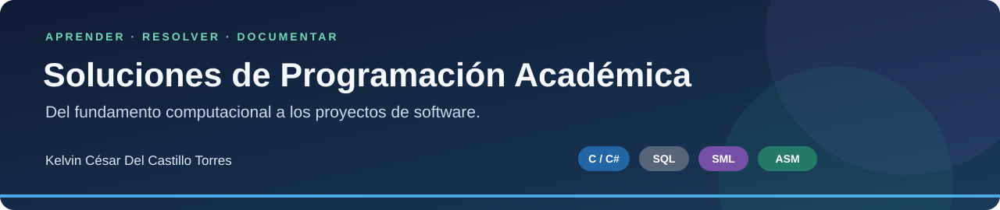

# Soluciones de Programación Académica




Este repositorio reúne soluciones, actividades y trabajos de programación desarrollados durante mi formación académica en Ciencias de la Computación.

El objetivo principal es organizar, documentar y presentar ejercicios resueltos que evidencian mi evolución técnica en lógica de programación, programación orientada a objetos, programación funcional, bases de datos, análisis de algoritmos y resolución de problemas mediante código.

---

## Explorar el portafolio

[Materias y estados](#áreas-principales) · [Proyectos destacados](#proyectos-destacados) · [Evidencias originales](archivos-originales) · [Pendientes](PENDIENTES.md) · [Perfil del autor](https://github.com/jokxer8) · [Guía de presentación](GUIA-DE-ESTILO.md)

**Ruta de aprendizaje**

[00 · Sistemas](00-fundamentos-sistemas-computacionales) → [01 · Introducción](01-introduccion-programacion) → [02 · Programación](02-fundamentos-programacion) → [03 · Objetos](03-programacion-orientada-a-objetos) → [04 · Algoritmos](04-diseno-y-analisis-de-algoritmos) → [05 · Funcional](05-programacion-funcional-sml) → [06 · Datos](06-bases-de-datos)

Cada actividad conecta **enunciado → desarrollo → código → evidencia**. Las pruebas y sus límites se documentan en la materia correspondiente.

---

## Objetivo del repositorio

Presentar de forma profesional una selección de ejercicios y actividades académicas organizadas por áreas de aprendizaje, acompañadas de explicaciones, análisis, documentación y código fuente limpio.

Este repositorio funciona como evidencia de práctica constante, desarrollo del pensamiento lógico, aplicación progresiva de conceptos fundamentales y dominio de diferentes paradigmas de programación.

---

## Áreas principales

| Área | Descripción | Estado |
|---|---|---|
| [00 - Fundamentos de Sistema Computacionales](00-fundamentos-sistemas-computacionales) | Representación de datos, C, ensamblador FASM/NASM, memoria, listas, colas, pilas y proyecto de países. | Incorporado y documentado |
| [01 - Introducción a la Programación](01-introduccion-programacion) | Primeros algoritmos, diagramas, C++, ciclos y búsqueda de texto; siete actividades documentadas. | Incorporado y documentado |
| [02 - Fundamentos de Programación](02-fundamentos-programacion) | Ejercicios de entrada y salida de datos, variables, condicionales, ciclos, arreglos, cadenas, métodos y validaciones. | Completado |
| [03 - Programación Orientada a Objetos](03-programacion-orientada-a-objetos) | Ejercicios con clases, objetos, constructores, encapsulación, composición, herencia, clases abstractas, polimorfismo, archivos y serialización. | Completado |
| [04 - Diseño y Análisis de Algoritmos](04-diseno-y-analisis-de-algoritmos) | Ejercicios de recursividad, búsqueda, ordenamiento, programación dinámica, grafos implícitos, matrices y análisis de complejidad. | Completado |
| [05 - Programación Funcional-SML](05-programacion-funcional-sml) | Actividades de programación funcional, cálculo lambda, combinador Y, inferencia de tipos, árboles, signaturas, tipos abstractos y listas perezosas. | Completado |
| [06 - Bases de Datos](06-bases-de-datos) | Trabajos de modelado, normalización, consultas y objetos SQL, con proyecto final de hotel en C# y SQL Server. | Completado |
| [Archivos originales](archivos-originales) | Documentos originales utilizados como respaldo académico para seleccionar, organizar y documentar los ejercicios. | Conservado |

---

## Estructura general del repositorio

```text
soluciones-programacion-academica/
├── 00-fundamentos-sistemas-computacionales/
├── 01-introduccion-programacion/
├── 02-fundamentos-programacion/
├── 03-programacion-orientada-a-objetos/
├── 04-diseno-y-analisis-de-algoritmos/
├── 05-programacion-funcional-sml/
├── 06-bases-de-datos/
├── archivos-originales/
└── README.md
```

---

## Ejercicios y actividades destacadas

### Fundamentos de Sistema Computacionales

| Actividad | Conceptos principales |
|---|---|
| [Representación de datos y fundamentos](00-fundamentos-sistemas-computacionales/fundamentos-representacion-datos) | Sistemas de numeración, complemento a dos, IEEE 754 y tamaños de tipos. |
| [Programación en C y ensamblador FASM](00-fundamentos-sistemas-computacionales/c-y-ensamblador) | Doce ejercicios equivalentes de entrada/salida, decisiones, ciclos, primos y patrones. |
| [Estructuras y memoria dinámica](00-fundamentos-sistemas-computacionales/estructuras-y-memoria) | Diez ejercicios de estructuras, punteros, rectángulos, complejos y listas. |
| [Listas, colas y pilas](00-fundamentos-sistemas-computacionales/listas-colas-pilas) | Diecinueve ejercicios de búsqueda, agregación, eliminación, ordenamiento, FIFO y LIFO. |
| [Proyecto híbrido C y NASM](00-fundamentos-sistemas-computacionales/proyecto-hibrido-c-nasm) | Interoperabilidad C/ensamblador x64 para sumar, ordenar e intercambiar enteros. |
| [Gestión de países — Proyecto final](00-fundamentos-sistemas-computacionales/proyecto-final-paises) | Lista doblemente enlazada con nodo cabecera, carga CSV, consultas, inserciones, eliminación y cuatro criterios de ordenamiento. |

---

### Fundamentos de Programación

| Ejercicio | Conceptos principales |
|---|---|
| [Estadísticas básicas de un arreglo](02-fundamentos-programacion/estadisticas-basicas-arreglo) | Arreglos, ciclos, métodos, suma, promedio, mayor y menor |
| [Clasificación de números](02-fundamentos-programacion/clasificacion-numeros) | Condicionales, contadores, acumuladores y operador módulo |
| [Análisis de cadena de texto](02-fundamentos-programacion/analisis-cadena-texto) | Cadenas, caracteres, métodos y validaciones |
| [Calculadora con menú](02-fundamentos-programacion/calculadora-menu) | Menú interactivo, métodos, ciclos y operaciones matemáticas |
| [Búsqueda secuencial](02-fundamentos-programacion/busqueda-secuencial-arreglo) | Arreglos, búsqueda lineal, validación y recorrido secuencial |

---

### Programación Orientada a Objetos

| Ejercicio | Conceptos principales |
|---|---|
| [Teléfono móvil POO](03-programacion-orientada-a-objetos/telefono-movil-poo) | Clases, objetos, composición, propiedades y métodos |
| [Matriz 2x2 POO](03-programacion-orientada-a-objetos/matriz-2x2-poo) | Clases, constructores, determinante, inversa y validación |
| [Agenda de citas POO](03-programacion-orientada-a-objetos/agenda-citas-poo) | Enumeraciones, listas, objetos, validaciones y excepciones |
| [Avisos con archivo y serialización](03-programacion-orientada-a-objetos/avisos-archivo-serializacion-poo) | Archivos, listas, JSON, serialización y deserialización |
| [Sistema de nómina con polimorfismo](03-programacion-orientada-a-objetos/sistema-nomina-polimorfismo-poo) | Abstracción, herencia, clases abstractas, sobrescritura y polimorfismo |

---

### Diseño y Análisis de Algoritmos

| Ejercicio | Conceptos principales |
|---|---|
| [Fibonacci recursivo](04-diseno-y-analisis-de-algoritmos/fibonacci-recursivo) | Recursividad, casos base, memoización y complejidad |
| [Búsqueda binaria](04-diseno-y-analisis-de-algoritmos/busqueda-binaria) | Búsqueda eficiente, arreglos ordenados y complejidad O(log n) |
| [QuickSort](04-diseno-y-analisis-de-algoritmos/ordenamiento-rapido-quicksort) | Divide y vencerás, pivote, recursividad y ordenamiento |
| [Subsecuencia creciente con suma máxima](04-diseno-y-analisis-de-algoritmos/subsecuencia-creciente-suma-maxima) | Programación dinámica y reconstrucción de solución |
| [Cambio de monedas limitado](04-diseno-y-analisis-de-algoritmos/cambio-monedas-limitado) | Programación dinámica, optimización y restricciones |
| [Conteo y conexión de islas](04-diseno-y-analisis-de-algoritmos/conteo-y-conexion-de-islas) | Matrices, BFS, grafos implícitos, máscaras de bits y optimización |

---

### Programación Funcional-SML

| Actividad | Conceptos principales |
|---|---|
| [Cálculo Lambda - Fundamentos](05-programacion-funcional-sml/calculo-lambda-fundamentos) | Cálculo lambda, árboles de sintaxis, sustitución, reducción beta y forma normal |
| [Combinador Y y Fibonacci en SML](05-programacion-funcional-sml/combinador-y-fibonacci-sml) | Combinador Y, punto fijo, Fibonacci, recursividad y funciones de orden superior |
| [Función Map e Inferencia de Tipos en SML](05-programacion-funcional-sml/map-inferencia-tipos-sml) | Map, listas, Hindley-Milner, tipos polimórficos y funciones de orden superior |
| [Serialización de Árboles de Expresión en SML](05-programacion-funcional-sml/serializacion-arboles-expresion-sml) | Tipos recursivos, árboles binarios, pattern matching, preorden, enorden y postorden |
| [Estructuras, Signaturas y Tipos Abstractos en SML](05-programacion-funcional-sml/estructuras-signaturas-tipos-abstractos-sml) | Signaturas, estructuras, records, listas de asociación, excepciones y tipos abstractos |
| [Listas Perezosas en SML](05-programacion-funcional-sml/listas-perezosas-sml) | Evaluación diferida, secuencias infinitas, mapSeq, filterSeq, factorial y Fibonacci |

---

### Bases de Datos

| Actividad | Conceptos principales |
|---|---|
| [Flotilla de Aeronaves - Modelo Entidad-Relación](06-bases-de-datos/flotilla-aeronaves-modelo-relacional) | Entidades, atributos y cardinalidades, Claves primarias y foráneas, Relaciones temporales, Transformación al modelo relacional, Normalización hasta 3FN, Diccionario de datos |
| [Cine - Modelado y Normalización](06-bases-de-datos/cine-modelado-normalizacion) | Modelo entidad-relación, Modelo relacional, Primera, segunda y tercera forma normal, Dependencias funcionales, Diccionario de datos |
| [Reservas de Coches - Creación y Carga de Datos](06-bases-de-datos/reservas-coches-creacion-datos) | SQL Server y T-SQL, DDL y DML, Claves y restricciones, Relación recursiva de aval, Atributos derivados |
| [Alquiler de Coches - Consultas SQL](06-bases-de-datos/alquiler-coches-consultas) | Claves compuestas, Relación muchos a muchos, JOIN y subconsultas, GROUP BY y HAVING, ALTER TABLE, Funciones agregadas |
| [Bolsa de Empleo - Vistas, Procedimientos y Auditoría](06-bases-de-datos/bolsa-empleo-objetos-sql) | Vistas, Procedimientos almacenados, Funciones escalares, Triggers, Tablas inserted y deleted, Agrupación temporal |
| [Restaurante - Consultas del Segundo Parcial](06-bases-de-datos/restaurante-consultas-segundo-parcial) | DISTINCT y JOIN, EXISTS, CTE, Agregaciones, Vistas, Funciones escalares |
| [Sistema de Reservas de Hotel - Proyecto Final](06-bases-de-datos/hotel-reservas-proyecto-final) | C#, Windows Forms, SQL Server, ADO.NET, reservas, facturación y roles |

---

## Proyectos destacados

| Proyecto | Descripción | Tecnologías | Estado |
|---|---|---|---|
| [Sistema de Reservas de Hotel](06-bases-de-datos/hotel-reservas-proyecto-final) | Proyecto final grupal para gestionar clientes, habitaciones, reservas, servicios, facturación y operaciones hoteleras. Incluye aplicación, scripts, diseño y documentación de instalación. | C#, Windows Forms, .NET Framework 4.8, SQL Server y ADO.NET | Incorporado y documentado; compilación y 79 pruebas SQL verificadas |
| [Gestión de países](00-fundamentos-sistemas-computacionales/proyecto-final-paises) | Proyecto final con 227 registros CSV, lista doblemente enlazada y gestión de memoria. | C17 | Compilado y verificado localmente |

La [comparación C/FASM en Linux](00-fundamentos-sistemas-computacionales/PRUEBAS-LINUX.md) verifica doce pares de programas con **132 comparaciones correctas y 0 fallidas**.

[](https://github.com/jokxer8/soluciones-programacion-academica/actions/workflows/fundamentos-linux.yml)

El proyecto de países se encuentra en [Fundamentos de Sistema Computacionales](00-fundamentos-sistemas-computacionales/proyecto-final-paises), con su CSV y pruebas de estructuras dinámicas.

El proyecto del hotel conserva los créditos del equipo y las cuentas de demostración. Su documentación explica el orden de instalación y registra [79 pruebas funcionales SQL correctas](06-bases-de-datos/hotel-reservas-proyecto-final/docs/PRUEBAS-FUNCIONALES.md), verificadas localmente y en Actions. Permisos, inactividad, filtros por sucursal, exportaciones, configuración de conexión y [almacenamiento PBKDF2 de contraseñas](06-bases-de-datos/hotel-reservas-proyecto-final/docs/SEGURIDAD-CONTRASENAS.md) verificados; véase el [cierre de tareas](06-bases-de-datos/hotel-reservas-proyecto-final/docs/CIERRE-TAREAS.md).

El [tablero HotelReservas - Mejoras y pruebas](https://github.com/users/jokxer8/projects/1) organiza las pruebas y mejoras con prioridades y estados. El [seguimiento del hotel](06-bases-de-datos/hotel-reservas-proyecto-final/docs/SEGUIMIENTO.md) resume el alcance y enlaza las tareas del repositorio.

[](https://github.com/jokxer8/soluciones-programacion-academica/actions/workflows/hotel-build.yml)

---

## Tecnologías utilizadas

- C#
- C17
- C++17
- Ensamblador x86-64 (FASM y NASM)
- .NET
- Standard ML
- SQL
- Aplicaciones de consola
- GitHub
- Markdown
- PDF como evidencia documental
- Archivos originales como respaldo académico

---

## Habilidades evidenciadas

Este repositorio evidencia competencias en:

- Resolución de problemas computacionales.
- Diseño de soluciones mediante código.
- Aplicación de lógica de programación.
- Uso de estructuras de control.
- Manejo de arreglos, cadenas, listas y matrices.
- Programación orientada a objetos.
- Uso de clases abstractas, herencia y polimorfismo.
- Programación funcional con Standard ML.
- Comprensión del cálculo lambda.
- Uso de funciones de orden superior.
- Inferencia de tipos mediante Hindley-Milner.
- Definición de tipos de datos recursivos.
- Uso de signaturas, estructuras y tipos abstractos.
- Simulación de evaluación diferida mediante listas perezosas.
- Programación dinámica.
- Análisis de complejidad algorítmica.
- Modelado entidad-relación y normalización.
- Consultas T-SQL y programación de objetos de bases de datos.
- Integración de SQL Server con C# y ADO.NET.
- Organización de evidencia académica.
- Programación en C, memoria dinámica e interoperabilidad con ensamblador.
- Pruebas reproducibles en Windows y Linux mediante GitHub Actions.
- Documentación técnica en Markdown.
- Organización profesional de repositorios en GitHub.

---

## Nota sobre los archivos originales

La carpeta `archivos-originales` conserva los documentos originales utilizados como base académica.

A partir de esos documentos se seleccionan ejercicios representativos y se organizan en carpetas individuales con versiones limpias y documentadas.

Cada ejercicio o actividad documentada puede contener:

```text
nombre-del-ejercicio/
├── README.md
├── desarrollo.md
├── solution.cs / solution.cpp / solution.sml / solution.c / scripts.sql
└── evidencia.pdf
```

---

## Estado actual

Los trabajos aún abiertos y las limitaciones de verificación se resumen en [Pendientes del repositorio](PENDIENTES.md).

El repositorio se encuentra en expansión.

Los estados describen la organización de la evidencia disponible. Cada materia documenta por separado las pruebas ejecutadas y sus límites; «Completado» no implica cobertura exhaustiva ni acredita una nota institucional.

Actualmente están organizadas las secciones de:

- Fundamentos de Sistema Computacionales (evidencia disponible incorporada y documentada).
- Introducción a la Programación.
- Fundamentos de Programación.
- Programación Orientada a Objetos.
- Diseño y Análisis de Algoritmos.
- Programación Funcional-SML.
- Bases de Datos.

---

## Autor

**Kelvin César Del Castillo Torres**

Estudiante de Ciencias de la Computación, enfocado en fortalecer su perfil técnico mediante la organización profesional de proyectos académicos, resolución de problemas, documentación de código y construcción progresiva de un portafolio académico en GitHub.
