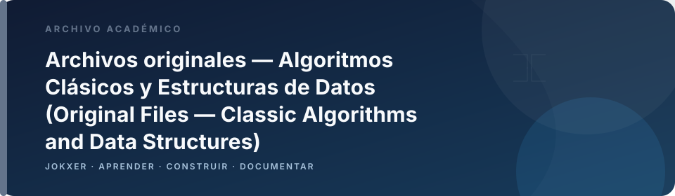

<h1 align="center"></h1>

Esta sección mantiene la trazabilidad del material utilizado para documentar [ICC-211-T Algoritmos Clásicos y Estructuras de Datos](../../04-algoritmo-clasico-y-estructura-de-datos/README.md).

## Qué contiene el origen

La carpeta local reúne el programa de la materia, presentaciones, guías, ejercicios, proyectos, documentos de apoyo y entregas escaneadas. El [inventario detallado](INVENTARIO.md) identifica los tipos de documentos y su relación con las unidades del curso.

## Criterio de publicación

El repositorio publica el mapa de contenidos elaborado a partir de las fuentes. La carga de un PDF de enunciado fue rechazada por la revisión automática de publicación: el archivo se transmitía truncado y sus metadatos identificaban a una tercera persona. Por eso no se vuelven a adjuntar aquí copias binarias de fuentes con atribución o datos personales de terceros.

Las diapositivas y referencias creadas por docentes o autores externos se usan para identificar los temas, pero no se redistribuyen como archivos completos. Las entregas seleccionadas se publican en la carpeta de la materia 04 con nombres normalizados; se identifican como entregas académicas, no como soluciones verificadas. Otras variantes y escaneos siguen descritos en el inventario sin adjuntar copias de fuentes de terceros. El nombre y el identificador del autor no se consideran suficientes para demostrar que el contenido de terceros está autorizado para su publicación.

Los archivos originales del equipo del usuario permanecen intactos. Esta carpeta proporciona un inventario público para que la materia principal documente exactamente qué se revisó y qué queda por integrar.

## Navegación

- [Materia 04](../../04-algoritmo-clasico-y-estructura-de-datos/README.md)
- [Mapa de materiales](../../04-algoritmo-clasico-y-estructura-de-datos/MATERIALES.md)
- [Inventario de fuentes y estado](INVENTARIO.md)

[Volver a archivos originales](../README.md)
