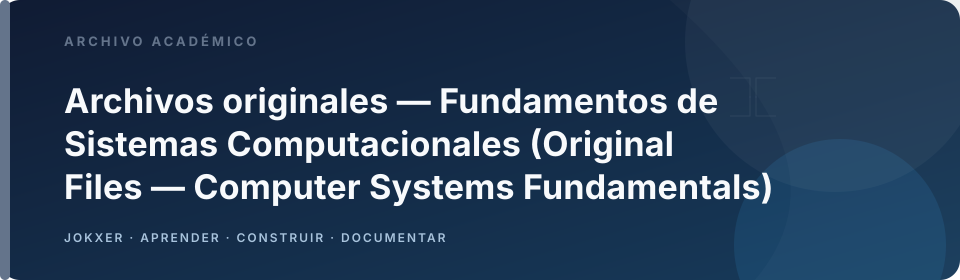

<h1 align="center"></h1>

## En palabras simples

Aquí se conservan los materiales de origen de esta sección. Si quieres entender primero el tema, abre la [materia y sus fichas](../../02-fundamentos-sistemas-computacionales/README.md). Usa el archivo original para comparar la consigna o la entrega con lo explicado, no para confundir una con la otra.

Respaldo de los trabajos seleccionados para [la sección 02](../../02-fundamentos-sistemas-computacionales). El código se publica una sola vez en las actividades; el inventario relaciona esos archivos con sus rutas académicas originales.

- `documentos/`: enunciados y primer parcial manuscrito.
- `referencias-visuales/`: tablas aportadas con las notas.
- `notas/` y `notas-asignacion-02/`: explicaciones históricas.
- `proyecto-final/`: guía DOCX y notas de la entrega.
- [INVENTARIO.md](INVENTARIO.md) e [inventario.json](inventario.json): clasificación exhaustiva y hashes.

Se retiró la matrícula de las páginas 1 y 3 del parcial público y de la nota de la aplicación. La nota de teoría omite el registro personal de asistencia. Los originales locales permanecen intactos. Los hashes públicos reflejan esas diferencias.

No se incluyen tres libros, 22 módulos PDF/PPTX de Huawei y su ZIP, cuatro archivos comprimidos de entregas, un ejecutable ni dos configuraciones locales. Los libros y módulos no son evidencia de autoría o certificación. Los comprimidos se inspeccionaron: las fuentes de código tienen sus equivalentes seleccionados; el `Leerme.txt` adicional del híbrido se trata como nota de empaquetado.

[Auditoría](../../02-fundamentos-sistemas-computacionales/AUDITORIA.md) · [Archivo general](../README.md)
